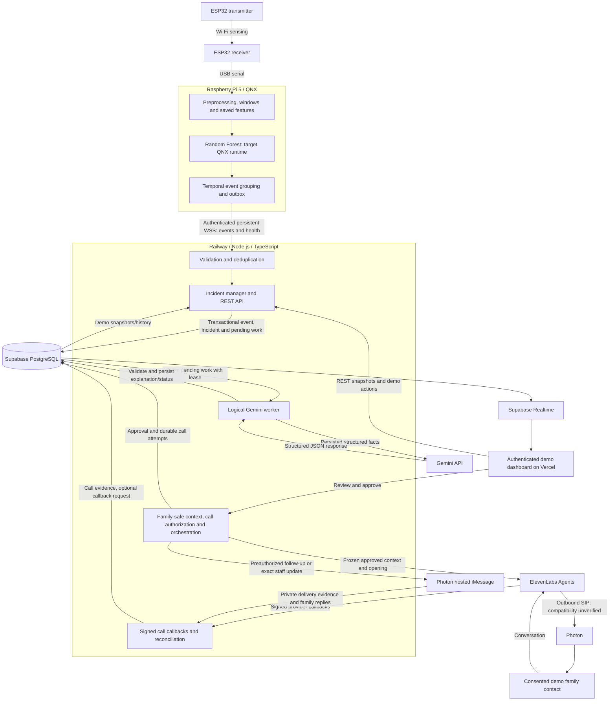

# Blissey Beacon — PROJECT_SPEC

Event: LA Hacks 2026. Last updated: 2026-10-18.
Document steward: Chloe (proposed); component owners review their contracts.
Status: authoritative specification; cloud/provider evidence recorded; team confirms QNX sensing/transport and inference-runtime integration; full hardware/model parity unverified here.

**Confirmed** means selected in the complete team request, not proven operational.
**Proposed** means an implementation detail awaiting owner agreement. **TBD / Not
yet verified** means evidence or a decision is missing. Nothing described as a
planned component should be interpreted as working software.

## 1. Executive Summary

Blissey Beacon explores camera-free possible-fall detection for senior living
facilities. ESP32 Wi-Fi Channel State Information (CSI) feeds a Random Forest
classifier trained using Veri. Local inference on a Raspberry Pi 5 with QNX is the
target architecture. The team confirms QNX OS sensing/transport on Pi 5 and
integration of QNX's python3-tflite-runtime from oss.qnx.com; execution/parity of the
trained forest through that runtime remains unverified here. Structured
events travel over WSS to a Railway Node.js/TypeScript backend backed by Supabase PostgreSQL. An authenticated
Vercel demo dashboard shows incidents; Gemini API generates grounded explanations
asynchronously. Operators review and authorize bounded conversational family calls: Railway
freezes a family-safe context and opening message, ElevenLabs Agents conducts the
conversation, and Photon supplies the planned outbound SIP telephony connection.
Independently consented Photon-hosted iMessage adds a reviewed call follow-up,
written updates and family replies; see §20. Supabase Auth operator login and facility membership are required.

The MVP uses one room and one person with controlled staged falls and normal
movement. This is an experimental proof of concept, not a clinically validated
fall detector, medical diagnosis tool, or emergency response device. It is not
suitable for unsupervised medical safety monitoring.

The repository now contains Slice 2 ingestion, incident reads, simulator and local
Docker verification. Hosted synthetic ingestion and dashboard integration were
verified on 2026-10-17. This is not evidence of a deployed hardware sensing system,
trained model or successful sponsor integration. Section 29 records source paths
and exact verification limits.

## 2. Product Goals and Non-Goals

### Confirmed goals

- Detect temporal CSI patterns associated with staged falls without cameras or wearables.
- Keep Model 1 inference local on Pi/QNX and send structured events instead of raw CSI.
- Give operators immediate room alerts, health visibility, incident history, and response actions.
- Explain uncertain events factually and coordinate reviewed family notifications.
- Demonstrate an end-to-end MVP before pursuing stretch functionality.

### Confirmed scope

One ESP32 transmitter, one ESP32 receiver, one Pi 5 running QNX, one monitored room,
one person, one local Random Forest classifier, one incident-explanation language model,
a cloud backend, an operator website, and one operator-authorized conversational
family-call flow through ElevenLabs and Photon, with independently authorized
iMessage follow-ups and a family reply inbox. One primary consented contact per
fictional resident and one outbound call per incident/contact define the MVP unless
an operator explicitly authorizes a retry. The conversational LLM is configurable;
Gemini Flash is the preferred candidate, with voice-agent compatibility unverified.

Excluded: person identification, full-body pose, heart-rate/breathing estimation,
medical diagnosis, multiple-person tracking, validated cross-facility performance,
and automatic family calls without explicit operator review and approval. Multi-room
monitoring is stretch even though the UI should accommodate multiple room cards.

## 3. User Personas: Operators and Families

The MVP uses fictional residents and staged incidents, with Supabase Auth for
operator identity. A single shared demo operator account is acceptable; its actions
identify the shared account, not an individual staff member. No anonymous operator
data access or mutations are permitted. Accounts require explicit facility membership.

| Persona | Needs | Access boundary |
| --- | --- | --- |
| Demo operator/caregiver | Room/facility view, health, history and incident actions | Supabase Auth identity plus assigned facility membership |
| Consented family recipient | Explicitly reviewed relevant updates | Preconfigured consented contact; no operator access without membership |

Acknowledgment is not notification approval or confirmation of injury. Notification
content excludes raw CSI, experimental scores and unsupported clinical claims.

## 4. Final System Architecture

The following architecture is selected for the MVP; its end-to-end deployment
and hardware/provider integrations remain unverified.



The Gemini worker is a logical module within the single Railway backend, not an
independent microservice. The ESP32 receiver does not run Model 1. Model 1 and
temporal grouping stay on QNX. Only structured
inference events and device health travel to the backend; QNX has no direct
database access. No MacBook intermediary, developer laptop, home GPU node or
self-hosted generative inference is required at runtime. Railway Docker deployment
and synthetic hosted WSS/REST/Gemini/Realtime integration are verified. Actual QNX
compatibility, live calling and broader operational limits still require verification.

## 5. Hardware and Network Architecture

### Public domains and deployment targets

The website domain is **blissey-beacon.health**, targeting Vercel. The planned
Railway API subdomain is **api.blissey-beacon.health**, with secure device endpoint
`wss://api.blissey-beacon.health/api/devices/v1/stream`. Supabase uses its assigned
project URL for Auth/Realtime/database connectivity. DNS, certificates and provider
configuration are recorded with scoped synthetic evidence in
[docs/deployment-verification.md](docs/deployment-verification.md). Root `.env.example`,
`vercel.json`, `railway.json`, the production backend Dockerfile and
[docs/deployment.md](docs/deployment.md) provide the setup handoff. The provisioned
Supabase production project is not modified by local verification.


Owner: Emilia for sensing and serial output; Chloe for Pi/QNX consumption.

| Link | Confirmed transport | Validation gate |
| --- | --- | --- |
| ESP32 TX → ESP32 RX | Wireless Wi-Fi radio signals for CSI sensing | Stable channel, firmware and reproducible placement |
| ESP32 RX → Pi | Direct USB serial using existing receiver output; not WebSocket | Actual baud, framing, USB driver and QNX device access |
| Pi → backend | Persistent secure WebSocket; Pi client, backend server | TLS, authentication, reconnects and durable event acknowledgments |
| Backend → Model 2 | Server-side Gemini API call with persisted structured facts | Model/version, structured output, privacy and provider compatibility |
| Backend → frontend | Authenticated demo REST and Supabase Realtime | Demo-only access policies, snapshots and reconnect recovery |
| Backend → ElevenLabs → Photon | Operator-authorized outbound call through planned SIP trunk | Verify agent, Photon trunk, call correlation and notification-spoken evidence with a consented test phone |
| ElevenLabs → backend | Signed provider webhooks | Signature/timestamp validation, durable deduplication and reconciliation |

Emilia must document board models, TX/RX roles, firmware revision, Wi-Fi channel,
CSI encoding, measured packet rate, serial baud, placement, height, participant
movement direction, room layout, and collection metadata. Preserve timestamps and
packet-integrity evidence. Do not infer sampling frequency or subcarrier count
from an ESP32 model name.

On serial loss or a long data gap, clear invalid temporal context, report degraded
sensing, and require a full valid window before inference resumes. Diagnose QNX
USB support first; a supported adapter or transport change needs team approval.
Do not silently replace USB serial, QNX, or local inference.

## 6. Technology Stack

The following selections define the planned MVP;
selected providers are not evidence of deployment or integration.

| Layer | Decision | Status |
| --- | --- | --- |
| Sensing | ESP32 transmitter and receiver | Confirmed; boards/firmware TBD |
| Edge hardware/OS | Raspberry Pi 5, QNX OS | Team confirms ESP32 sensing collection and secure result transmission; image/BSP/toolchain and actual logs not inspected here |
| Model 1 training | Veri | Team confirms Random Forest training on CSI data; job/configuration/evaluation artifacts not inspected in this repository |
| Model 1 baseline | Random Forest classifier | Selected by the team; supersedes the proposed Keras 1D CNN; implementation/library and hyperparameters TBD |
| Edge inference format | Versioned Random Forest artifact and frozen feature pipeline | Export format, eligible QNX module and runtime compatibility not yet verified |
| QNX inference runtime | python3-tflite-runtime from oss.qnx.com | Team confirms runtime integration to support local fall-detection inference; trained-forest export/execution/parity and sponsor eligibility not established here |
| Backend hosting/runtime | Railway, Node.js / TypeScript, Fastify + `@fastify/websocket`; single deployment | Docker deployment and synthetic WSS/REST verified; actual QNX unverified |
| Database | Supabase PostgreSQL | Four migrations applied to approved demo project; synthetic event/incident/job persistence and deduplication verified |
| Realtime | Supabase Realtime with operator JWT and facility RLS | Hosted authorized delivery and dashboard live update verified |
| Persistence | Direct PostgreSQL via `pg` | Same checked-out client for BEGIN/COMMIT/ROLLBACK; database uniqueness |
| Monorepo | pnpm workspaces for TypeScript only | Two deployable apps; independent QNX/Python toolchains |
| Operator identity | Supabase Auth | Shared demo account acceptable; explicit facility membership |
| UI | React/Vite browser demo on Vercel, implemented from Paper designs | Minimal deployed shell: login, room/history and live incident verified; full design/workflows remain pending |
| Model 2 | Hosted Google Gemini API, configured `gemini-3.5-flash-lite` | Live model/local path and hosted synthetic Railway/Supabase/Realtime path verified |
| Veri sponsor use | Random Forest training for Model 1 | Team-confirmed use; training does not by itself establish fine-tuning prize eligibility |
| Conversational voice | ElevenLabs Agents; configurable conversational LLM, Gemini Flash preferred | Agent configuration and one consented live synthetic-incident conversation verified; automated spoken-evidence mapping pending |
| Family messaging | Photon hosted iMessage via Railway | Assignment/onboarding and one isolated Docker + real Photon message delivery and correlated ACK verified; hosted rollout pending |
| Family telephony | Photon outbound SIP trunk connected to ElevenLabs | One consented outbound call verified through the configured trunk; broader failure/recovery coverage pending |

TypeScript dependency versions are pinned in pnpm-lock.yaml and the Docker
toolchain. Setup/check commands are documented in docs/development.md. Training,
QNX configuration remains unverified; hosted demo settings and limits are recorded
in docs/deployment-verification.md.

Hosted iMessage is a separate Photon channel managed by the Railway backend;
PHOTON_PROJECT_ID/PHOTON_API_KEY and PHOTON_IMESSAGE_SENDER_NUMBER are server-only.
No Mac-local messaging package is permitted at runtime.

## 7. Dataset Format and Collection

Dataset: [emiluvu/bb-data](https://github.com/emiluvu/bb-data), separate from the
application. No dataset cloning or raw CSI download into this repository is
allowed. The training environment may read a pinned dataset revision in temporary
runtime storage; record the actual Veri data-access workflow with the model artifacts.

A read-only GitHub contents request on 2026-10-17 returned 404. This may reflect
access permissions or repository availability; its actual format remains **Not yet
verified**. No files, counts, license, labels, or hardware configuration were
inspected. Restore access before implementing the parser or labeling.

| Provisional file | Reported purpose | Must verify |
| --- | --- | --- |
| `measurements.jsonl` | CSI measurements and packet metadata | Keys, units, I/Q layout, timestamps, dimensions and malformed-record rules |
| `metadata.json` | Recording, participant, activity and configuration | Label vocabulary, grouping IDs, collection protocol and consent/provenance |
| `events.json` | Optional fall-event annotations | Timestamp/interval semantics, clock alignment and completeness |
| `raw_serial.bin` | Preserved serial output where available | Framing, encoding and relationship to parsed measurements |

| Category | Label evidence | Treatment |
| --- | --- | --- |
| Positive recording | Fall annotated with actual timestamps or intervals | Label selected windows using event timing, never the entire recording |
| Verified negative | Metadata or collection protocol confirms no fall | Valid windows may be negative even without `events.json` |
| Uncertain | Insufficient labels or contradictory annotations | Review; exclude from supervised training until resolved |
| Invalid | Corrupt data, unusable timing or incompatible layout | Exclude and report reason |

An absent `events.json` is expected for some negative recordings. Absence alone,
or an empty event file alone, is insufficient evidence of a negative label.

Emilia leads controlled collection; Chloe audits labels and usability. Audit
recording counts, durations, fall counts, activity balance, packet rates, feature
layouts, missingness, exclusions, and trial/session/participant groups. Use staged
events and fictional resident/room identifiers; no real resident data for the demo.

## 8. Model 1: Objectives and Training Method

Owner: Chloe; Chace collaborates on edge/backend interfaces.

**Selected model:** Random Forest classifier. The user confirmed that Veri was
used to train it on the CSI data stream and approved reconciling this specification
with that decision on 2026-10-18. This supersedes the earlier Keras 1D CNN/Colab
selection. It does not establish inspected training artifacts, held-out performance,
QNX execution or sponsor eligibility.

The existing product contract remains supervised binary possible-fall
classification: each example represents a fixed-length CSI window, with target
`0` for non-fall and `1` for fall from verified annotations. Confirm the trained
artifact's actual class labels and feature schema before connecting it to this
contract; do not assume an unaudited artifact already produces compatible scores.
This is not an LLM or generative classification pipeline. Continuous local
inference on QNX remains the deployment target. Scores are not calibrated
probabilities unless calibration is evaluated.

## 9. Model 1: Base Architecture

**Selected baseline:** Random Forest trained using Veri. The model consumes a
fixed feature representation derived from CSI windows. The exact feature
extraction, class mapping, training library/version and hyperparameters must be
recorded from the team's artifact; they are not inferred from the model name.

| Boundary | Required artifact / validation |
| --- | --- |
| Window | Frozen timing, channel layout and data-quality policy from Section 10 |
| Features | Saved extraction code/configuration, feature count, order and dtype |
| Forest | Versioned trained artifact, implementation/version, seed and tree settings |
| Output | Explicit class-to-score adapter for `confidence_scores` in Section 15 |
| Deployment | QNX-compatible representation and matching predictions on approved fixtures |

No tree count, depth, feature statistic, inference latency or accuracy is claimed
without the corresponding training or runtime evidence. Neural-network layers,
Adam, binary cross-entropy and sigmoid activation are no longer Model 1 requirements.

## 10. Sliding Window Preprocessing and Labeling

### Shared training/inference pipeline

Validate packet → parse verified I/Q layout → amplitude → mask invalid subcarriers
→ handle missing samples → align/resample time → normalize → fixed windows.
Apply the frozen feature extractor after windowing. Training then assigns labels;
live inference applies the same feature extractor and saved forest instead.

For verified complex CSI, `amplitude = sqrt(I² + Q²)`. Verify ordering, encoding,
invalid values and layout first. Use training-only normalization statistics in
all partitions and on QNX. Do not fit a fresh live scaler.

### Window definition and overlap

A single packet cannot show the temporal progression of a fall. A window collects
a fixed duration of measurements, and the stride controls how often another
prediction is made. Starting settings are three seconds and a 0.5-second stride.

At an **illustrative**, unconfirmed 100 Hz rate:

```text
Window 1: [0.0 s, 3.0 s)    300 timesteps
Window 2: [0.5 s, 3.5 s)    300 timesteps
Window 3: [1.0 s, 4.0 s)    300 timesteps
Window 4: [1.5 s, 4.5 s)    300 timesteps
Window 5: [2.0 s, 5.0 s)    300 timesteps
```

One input is `[300, C]`; a batch is `[batch_size, 300, C]`. These are dimensions
after alignment at the assumed rate, not a claim of actual collection frequency.
Overlap captures events crossing window boundaries and permits frequent updates,
but makes neighboring windows highly correlated. Split complete trial/session/
participant groups **before** generating windows; never randomly split overlapping
windows into training and evaluation sets.

### Proposed deterministic implementation rules

Use half-open windows `[start, end)` on the manifest's uniform time grid. At a
chosen rate `f`, require integer `T = duration * f` and integer stride samples;
otherwise explicitly define and save a rounding policy. Anchor the grid to each
recording start for training and a clean stream start for live inference.
Never join separate recordings, sessions, or data discontinuities into one window.

Freeze channel order/mask, resampling/interpolation method, maximum allowed gap,
valid-sample fraction, normalization, window/stride and grid policy in the manifest.
Small-gap interpolation is permitted only under that declared policy; long gaps,
corruption, nonfinite values or incompatible layouts invalidate the window.
Do not substitute zero-filled normal predictions. Reset temporal confirmation
when inference quality is invalid. Specific gap limits await dataset inspection.

### Labeling policy

Use actual fall intervals or point annotations on the same clock as the samples.
The policy and all boundary parameters must be configurable and selected before
final evaluation.

Proposed initial event-centered policy: a positive window contains the annotated
fall onset and enough configured pre/post-event context. Windows intersecting a
fall without sufficient context are ambiguous and excluded. For interval labels,
the team may instead select an explicit minimum-overlap criterion, saved in the
manifest; do not mix policies silently. An annotation containing only an onset
must not be given an invented end time. Exclude uncertain adjacent windows until
the annotation convention supports a defined boundary margin.

Verified negative recordings yield negative valid windows. Windows outside a fall
in a positive recording may be negative only where annotation completeness and
the configured exclusion margin establish normal activity. Uncertain recordings
remain excluded. A recording containing one fall is not positive at every moment.

### Live rolling buffer and event grouping

1. Read USB serial, validate and preprocess CSI using the frozen contract.
2. Append valid features to a bounded rolling buffer with monotonic timing.
3. Wait until a complete valid window exists; run Model 1.
4. Advance by the stride and repeat, retaining overlap.
5. Apply the temporal state machine to scores; transmit an event, not every score.

Proposed event states: `armed -> candidate -> triggered -> cooldown -> armed`.
Use a validation-selected threshold and persistence count; optionally use a lower
re-arm threshold with its own persistence. Emit one stable event ID per episode.
Continued high windows do not create repeated incidents. Re-arm only after the
configured reset condition and cooldown; invalid windows break confirmation.

Record `detected_at` when confirmation triggers. It is not exact physical onset.
An optional estimated onset requires a documented estimator and error evaluation.
Longer windows can capture more context but add startup/context latency and blur
timing. Shorter stride gives more frequent updates but increases correlated
predictions and compute. Higher thresholds/persistence can reduce false alarms
while missing events or delaying detection. Quantify these tradeoffs on validation
data rather than claiming exact fall timing from a window-level classifier.

## 11. Model Training and Evaluation

### Configuration and evidence to record

The earlier CNN optimizer/loss/epoch defaults are superseded. Record the actual
Veri training configuration rather than treating those defaults as forest settings.

| Parameter | Required record |
| --- | --- |
| Window length / stride | Previous proposal: 3 seconds / 0.5 seconds; reconcile with trained artifact |
| Feature pipeline | Exact transformations, order, count and training-only fitted state |
| Forest settings | Implementation/version, tree count, depth, split/leaf settings and random seed |
| Imbalance handling | Actual class weighting or sampling, if used |
| Training evidence | Veri job/run reference, dataset revision and split manifests |
| Input / output | Frozen CSI feature vector / verified class mapping and uncalibrated scores |

Chloe records seeds, dataset revision, split manifests, model, preprocessing
and training configuration. Use group-aware splitting and document the actual
evaluation tooling. Keep participant groups separate where possible; otherwise
use session/trial/recording groups and disclose generalization limits. Fit all
learned transforms on training only. Tune thresholds and persistence on validation;
freeze them before a final untouched test. Weighting or sampling for imbalance
must be recorded and confined to training.

| Metric | Reporting rule |
| --- | --- |
| Precision, recall, F1, confusion matrix | Window-level counts and class balance at a declared threshold |
| Event-level recall | Matched detected falls / annotated held-out falls; report missed falls |
| False alerts per monitoring hour | Unmatched alerts / verified normal monitoring hours |
| Detection latency | Trigger time minus annotated onset; report distribution and missed events separately |
| Event timestamp estimation error | Evaluate only if an onset estimator exists; otherwise mark not implemented |
| Runtime performance | QNX inference latency, end-to-end latency, memory and sustained throughput |

Proposed event matching: one detection per annotated fall within a declared timing
tolerance; specify that tolerance before testing. Extra unmatched episodes count
as false alerts, not additional true positives. Report observation duration, group
counts, exclusions, timing uncertainty and whether normal hours include downtime.

Evaluate sitting quickly, bending, crouching, intentional lying down, standing up,
walking, and background movement. No accuracy or false-alarm target has been
validated; agree numerical success targets after auditing available data. Report
untested rooms, people, placement changes and other limitations honestly.

## 12. Training and Artifact Management

**Team-confirmed:** Veri was used to train the Random Forest classifier on CSI
data. This documentation task does not start training or inspect the external
model repository, training job, dataset or evaluation results.

Required reproducibility workflow: pin the separate dataset revision, inspect/audit,
split groups before windowing, fit any preprocessing on training only, create
windows/features, train the forest, tune on validation, evaluate held-out data,
save the model and preprocessing, then compare exported and reference predictions
before transferring to QNX. Completion of these steps needs artifact evidence;
the user's training confirmation alone does not establish evaluation completion.

| Application repository may contain | Keep outside the application repository |
| --- | --- |
| Source, future training notebook/scripts, inference code, contracts, lightweight configs and reports | Raw CSI, duplicate archives, temporary tensors, large checkpoints and sensitive resident information |

Required artifact bundle: trained forest, Veri run reference, embedded representation,
checksum manifest, any fitted normalization state, feature extractor/order,
resampling policy, window/stride, class/label mapping, threshold/persistence/cooldown,
seeds, dataset commit, split-manifest hash, evaluation report and small approved
parity fixtures. Record library and export/runtime versions, feature dtype/layout,
runtime requirements and comparison tolerance. Host large artifacts separately
with versioned retrieval instructions; host and access policy are TBD. Never
commit dataset credentials or training-service tokens.

## 13. Veri Training Integration

Veri was used to train Model 1's Random Forest classifier on the CSI data stream,
as confirmed by the user on 2026-10-18. Record the actual Veri job, configuration,
artifact revision and evaluation report when supplied. Do not describe this use
as pretrained-model fine-tuning or claim measured performance without evidence.

The earlier proposed open-source Model 2 / Qwen / Veri SFT serving path remains
superseded by Gemini API. Veri training is separate from runtime incident
explanations; no self-hosted generative model is added to the product.

The team targets the Veri sponsor challenge, but Random Forest training on Veri
infrastructure does not itself establish fine-tuning prize eligibility. Confirm
current rules and required model/license/training/submission evidence with the
sponsor. Preserve the QNX, Espressif, Paper and Photon contracts; training or
sponsor participation never authorizes family notifications.

## 14. QNX Model Deployment and Inference

Owner: Chloe; Emilia supports serial integration. On 2026-10-18 the user confirmed
that QNX OS on Raspberry Pi 5 collects ESP32 Wi-Fi sensing data, securely transmits
results to the backend and integrates `python3-tflite-runtime` from
[oss.qnx.com](https://oss.qnx.com/) to support local fall-detection inference.
This records team-confirmed implementation, not a hardware test performed by this
documentation task. Capture the actual module/version and hardware logs; sponsor
eligibility and full model execution/parity are still separate validation gates.

Do not assume the Random Forest artifact executes through a TensorFlow Lite
runtime merely because that runtime is integrated. Document the forest's actual
export/adapter or other compatible inference path, and verify matching outputs
on QNX before claiming deployed forest inference.

1. Save the trained Random Forest and frozen preprocessing/feature configuration.
2. Select a representation and eligible QNX inference module that actually support
   the trained forest; format, library and module remain unverified.
3. Compare exported predictions against the training implementation on fixed
   held-out features using a declared tolerance; investigate class/threshold changes.
4. Confirm exact QNX image/BSP, hardware architecture, compiler/ABI, inference
   runtime, supported operators, USB driver, TLS/WSS and persistent storage.
5. Transfer versioned artifacts with checksums and reject incompatible manifests.
6. Load the model on actual Pi/QNX, reproduce golden outputs, measure resources
   and inference speed, then process live USB CSI into windows and events.

Prove serial reading and representative forest inference early. Conversion
success alone does not prove QNX compatibility. A Linux desktop inference result
is not a QNX result. Changing export format must preserve the model task and
input contract. Startup/loading failure or missing data yields degraded monitoring,
not a fabricated normal score. Do not move the required inference into the cloud
or substitute Linux without an explicit team architecture decision.

## 15. Model 1 Output Schema

The product's Model 1 interface remains binary. Its published
prediction schema uses generic named confidence scores:

```json
{"confidence_scores": {"fall": 0.91, "non_fall": 0.09}}
```

Map the trained forest's actual class outputs explicitly to `fall` and `non_fall`;
do not infer class order or assume sigmoid output. Validate the adapter against
the artifact before integration. Each value must be finite and within `[0, 1]`;
require the pair to sum to one within a documented floating-point tolerance. These are
uncalibrated scores, not established probabilities or additional activity classes.
Thresholding still uses the `fall` score. Changing the published vocabulary does
not add classifier capabilities or permit an unverified class mapping.

The QNX service owns thresholds, persistence, grouping, event IDs, timestamps,
device metadata, health and transport. A score alone is not an incident.

### Approved QNX → backend event schema v2

```json
{
  "event_id": "evt_102",
  "room_id": "room_102",
  "device_id": "pi_102",
  "event_type": "inference_result",
  "confidence_scores": {"fall": 0.91, "non_fall": 0.09},
  "detected_at": "2026-10-17T14:32:06-07:00",
  "sensor_status": "connected"
}
```

| Required field | Contract |
| --- | --- |
| `event_id` | Unique nonempty string, stable across retries; no UUID-only requirement |
| `room_id` | Configured room ID, separate from device ID |
| `device_id` | Raspberry Pi ID, checked against authenticated connection |
| `event_type` | Exactly `inference_result` for the current contract |
| `confidence_scores` | Object containing the validated binary score pair above |
| `detected_at` | ISO 8601 detection-trigger timestamp with timezone; offsets and `Z` accepted |
| `sensor_status` | Sensor health string; `connected` for a valid detection; proposed other health states are `degraded` and `disconnected` |

This explicitly supersedes v1's `event_type: possible_fall` and scalar
`fall_score`; it is a breaking schema revision, not unchanged v1. There are still
seven required top-level fields, with no mandatory version/envelope/window fields.
No deployed producer or consumer is evidenced; coordinate Chloe/Chace on the new
contract before implementation. Do not silently interpret a legacy payload as v2.
The existing proposed `/api/devices/v1/stream` route is retained for endpoint
compatibility; that route name does not imply acceptance of the superseded schema.
Any legacy acceptance or future route migration requires an explicit agreement.

`detected_at` is the temporal confirmation trigger, not necessarily physical fall
time. Backend records receipt time and monitors clock quality. QNX transmits
one event per grouped episode, not continuous score streaming. Optional future
fields remain `estimated_fall_at`, `post_event_motion`, `model_version`,
`sensor_quality`, and `inference_latency_ms`; none is required. Additional classes
require new evidence and an explicit model/schema decision.

## 16. WebSocket Protocol and Backend Ingestion

Slice 2 implements the retained endpoint with opaque bearer credentials stored as
SHA-256 digests in private device_credentials rows. Upgrade auth and per-message
transaction checks validate active credentials/device/room. Credential revocation
is honored on established streams. Event schema v2 in Section 15 is unchanged.
The existing pg transaction helper persists event, incident and pending job before
socket ACK. Identical JSONB payloads deduplicate across retries/restarts/concurrent
connections; changed facts or cross-device ID reuse reject. Separate health messages
persist monitoring state; no health event_ack or inferred incident is fabricated.
Details and error/queue policies are in [docs/slice-2.md](docs/slice-2.md).

The Pi handoff uses exact string IDs `device_id: "1"` and `room_id: "101"`.
These additional database records are distinct from the retained synthetic
`pi_102 → room_102` fixtures. Hosted assignment and the supplied SHA-256 credential were registered on
2026-10-18 UTC, and backend credential lookup verified the exact device/room/facility.
Actual QNX WSS acceptance remains unverified and requires separate evidence.
See [docs/qnx-registration.md](docs/qnx-registration.md) for the credential handoff,
SHA-256 registration, connection contract and verification limits.


Owners: Chloe (client), Chace (server). Required: persistent WSS, device
authentication, validation, event-ID deduplication and periodic health. The policies
below are proposed implementation details for their agreement.

| Concern | Proposed policy |
| --- | --- |
| Endpoint/version | `wss://<backend>/api/devices/v1/stream`; route retained; approved payload schema v2 per Section 15; no extra version field |
| Authentication | Scoped revocable device credential in handshake authorization header; verify TLS certificates; never put credentials in URLs |
| Room mapping | Server maps credential to device and room; reject a mismatched payload identity |
| Retry | Full-jitter exponential backoff from 1 to 30 seconds; credential rejection needs reprovisioning rather than a retry loop |
| Health | Every 10 seconds; stale after 30 seconds without accepted health; track sensing faults separately from socket liveness |
| Bounds | Proposed 16 KiB message maximum and bounded parsing/logging |
| Event delivery | Persist local outbox before send, remove only after durable backend ACK; at-least-once delivery with deduplication |
| Outbox | Proposed bounds: 1,000 events or 24 hours; expiration/overflow visibly increments loss counters; QNX persistence must be verified |
| Backend commit | Atomically store event, incident and pending explanation job before ACK; duplicate same payload returns same incident; conflicting ID reuse is rejected |

Deduplicate using globally unique `event_id`, also recording authenticated device
ownership. Reject an event ID reused by another device or with changed facts.
Do not create repeated incidents or notifications on retransmission. Retain
observed detection and receipt timestamps for delayed/out-of-order events; delayed
incidents still require fresh operator review before any demo notification.

Proposed ACK (a separate backend response, not an added inference-event requirement):

```json
{"type":"event_ack","event_id":"evt_102","incident_id":"inc_102","status":"accepted"}
```

Duplicate ACK uses `status: "duplicate"`. Proposed rejection:

```json
{"type":"error","event_id":"evt_102","code":"invalid_payload","retryable":false}
```

Validate required fields, lengths, timestamp parsing, finite named confidence
scores and identity. The Railway backend persists to Supabase PostgreSQL.
Retry transient storage/availability errors; do not endlessly retry malformed
payloads. Lost ACKs cause retransmission of the same event ID. A database failure
must not produce a successful ACK. After a backend restart, durable deduplication
still applies. Local inference continues offline within storage/resource limits.

Proposed distinct health message, distinguishable from events by `type`:

```json
{
  "type": "device_health",
  "device_id": "pi_102",
  "room_id": "room_102",
  "sent_at": "2026-10-17T14:32:10-07:00",
  "sensor_status": "connected",
  "model_status": "ready",
  "last_valid_frame_at": "2026-10-17T14:32:10-07:00",
  "outbox_depth": 0,
  "dropped_event_count": 0,
  "clock_synced": true
}
```

This health schema is proposed and independent of the detection-event payload schema. `last_valid_frame_at`
is nullable before valid input. Proposed model states: `loading|ready|error`.
Use ping/pong for transport liveness, but do not equate a live socket with working
sensing. Backend derives room monitoring state from receipt age, serial health and
model readiness. Preserve faults in UI and diagnostics.

## 17. Model 2: Gemini API and Input/Output

Owner: Chace. Use Google's hosted Gemini API to transform persisted structured
facts into human-readable incident explanations. It replaces the proposed
open-source/self-hosted Model 2 for the MVP; Model 1 is unchanged. The initial configured model is
`gemini-3.5-flash-lite`, verified with live structured output and local disposable
PostgreSQL/Realtime on 2026-10-17. The hosted synthetic Railway/Supabase/Gemini/Realtime
path was also verified on 2026-10-18 UTC; physical QNX remains unverified.
See [docs/gemini-pipeline.md](docs/gemini-pipeline.md) for the exact evidence.

Backend enriches persisted event facts with the room label, incident state,
audience and verified context. Example dashboard input:

```json
{
  "event_id": "evt_102",
  "event_type": "inference_result",
  "room_label": "Room 102",
  "detected_at": "2026-10-17T14:32:06-07:00",
  "confidence_scores": {"fall": 0.91, "non_fall": 0.09},
  "sensor_status": "connected",
  "audience": "operator"
}
```

Preserve the four-field output shape; illustrative text may describe an uncertain
possible fall based on persisted binary scores, never a confirmed physical event:

```json
{
  "event_id": "evt_102",
  "title": "Possible Fall Detected",
  "description": "The sensor reported a possible fall in Room 102.",
  "recommended_action": "Check on the resident in Room 102."
}
```

| Field | Backend validation responsibility |
| --- | --- |
| Input | Stored validated facts and minimal relevant context; never raw CSI |
| `audience` | `operator` or `family`; allowlist controls notification content, not website login |
| Output `event_id` | Must match the persisted input event |
| `title`, `description`, `recommended_action` | Required bounded strings; proposed limits 120/800/300 characters |
| Factual grounding | Reject reclassification, invented activities/positions, injury/diagnosis, confirmed-fall or invented staff/emergency-response assertions |

Use structured JSON output where supported, then independently validate fields,
identity, lengths and grounding before persistence. Do not send credentials, phone
numbers, unnecessary resident data or unverified descriptions. For family content,
omit scores and include only reviewed verified facts. Notes are data, not prompt
instructions. Record model/prompt version and input hash for traceability.

Gemini's key stays exclusively server-side. The browser and QNX never call Gemini.
Generation never initiates notifications or substitutes for explicit operator
review/approval. Keep deterministic same-schema fallbacks and cautious wording.
Explanation states are `pending | ready | fallback`; failures must not block
incident publication, incident actions or notification review. The implementation uses
a five-second timeout and at most one transient retry; broader provider limits
remain to be measured.
Durable processing and restart recovery are required by Section 18.

The implemented MVP uses `grounded-phrasing-v1`: Gemini selects among exact factual
wordings built from persisted input. Canonical schema, event identity and wording
are independently validated before persistence. This constrains generation rather
than relying on unrestricted prose or a keyword blocklist for factual grounding.
Each provider call times out after five seconds; one transient retry is allowed.
A database-backed retry delay is two seconds and each claim lease is 30 seconds.
A missing API key disables the worker and retains pending work without blocking
ingestion. Server-side key/model configuration and hosted rollout are explicit.

### Family-safe call projection

The operator-facing `grounded-phrasing-v1` descriptions include experimental scores.
Never pass the complete explanation directly to the voice agent. A separate backend
notification module projects persisted incident facts, the validated explanation and
explicitly operator-verified context into the family-safe contract in Section 20.
It excludes scores, CSI, private credentials and unsupported condition/staff claims.
No inference rerun or change to the four-field explanation output is required.
Persisted sensor facts remain the source of truth; Gemini provides grounded wording,
and ElevenLabs communicates the approved projection without reinterpreting CSI.

## 18. Backend and Database

Owner: Chace / Backend Team. Deploy a single Node.js/TypeScript application on
Railway with logical modules for authenticated WSS ingestion, validation and
deduplication, incident lifecycle, health monitoring, persistence, Gemini jobs,
authenticated demo REST, family-contact configuration, ElevenLabs/Photon call
approvals/dispatch, signed callbacks and audit/recovery. Do not introduce
independent backend services without a demonstrated requirement. Railway is the
selected MVP target; hosted synthetic WSS/REST and Gemini worker flow were verified.
Broader operational limits and physical QNX integration remain unverified.

Supabase PostgreSQL is the durable source of truth. Backend/database credentials
stay server-side; QNX neither connects directly to Supabase nor holds its secrets.

| Logical entity | Minimum information/invariant |
| --- | --- |
| Facility / Room | Separate IDs, facility membership, fictional labels, floor and static layout geometry |
| Device | Device ID, configured room, credential reference, connectivity and sensing health |
| User / staff scope | Supabase Auth subject and explicit facility membership; shared account is not individual staff attribution |
| Patient | Fictional resident identifier/display label; no real patient information |
| RoomAssignment | Patient/room mapping with assigned/released timestamps; preserve historical associations |
| InferenceEvent | Unique event ID, device ownership, validated payload/hash, detection and receipt times |
| Incident | ID, event reference, room, status, revision, lifecycle actors/timestamps, disposition and notes |
| Explanation | Incident, output, persistent generation status, model/prompt version and input hash |
| ExplanationJob | Durable pending work, unique work identity, attempts, next retry, claim/lease and terminal outcome |
| FamilyContact / consent | One primary contact per fictional patient, facility scope, private E.164 destination, relationship and grant/revocation evidence |
| Notification / call authorization | Incident revision, historical patient/contact and consent references, approver, immutable approved context/opening/policy and hash, idempotency key |
| NotificationCall / attempt / event | Durable job/attempt before dispatch, provider conversation/SIP IDs, transport status, connected and notification-spoken evidence, timestamps, optional callback request/bounded summary and deduplicated provider events |
| Audit | Device or authenticated operator subject, action, target, timestamp and outcome without secrets |

Proposed incident lifecycle remains `pending -> acknowledged -> responding -> resolved`.
Validate revision and allowed transitions, record action/time and bounded notes.
False alarm is a separate resolution outcome. Proposed outcomes remain
`reported_fall`, `false_alarm`, `unknown`; no clinical validation is implied.
Default proposal rejects skipped states; reopening remains TBD. Resolved incidents
remain in history. A shared demo account does not establish an individual staff identity. Notification state
remains independent from incident state (Section 20).

### Durable asynchronous explanation processing

1. Authenticate the device and validate its event/room identity and payload.
2. Transactionally persist the event, associated incident and pending explanation
   job with durable uniqueness. An identical retry returns the original incident;
   conflicting reuse is rejected and does not enqueue duplicate work.
3. ACK QNX only after that transaction commits. Incidents become available through
   REST/Realtime after commit, without waiting for Gemini. Independent network
   delivery means the browser may observe the commit before QNX receives its ACK.
4. The logical backend worker claims pending work using an atomic database
   claim/lease. Claim identity, lease expiry and conditional completion prevent
   competing workers or stale workers from publishing duplicate results.
5. Load persisted structured facts, call Gemini with timeout/bounded retries,
   validate the response, and transactionally persist the explanation and completed
   work status. Realtime makes the committed update visible to the dashboard.
6. Recover expired claims and unfinished work after restart. Persist retry counts,
   retry scheduling and generation state. Terminal failure stores a deterministic
   explanation and marks `fallback`. Retries/completion must be idempotent.

The implementation in apps/backend/src/explanations uses `SKIP LOCKED`, unique
lease tokens, canonical frozen input snapshots, and conditional transactional
completion/retry. Completion persists the explanation and advances the incident
revision in one transaction, driving the existing Realtime refetch. One deployment
runs WSS, REST and the worker together when configured. A provider timeout may
cause a repeated API call, so do not promise exactly-once external generation.
Database uniqueness and conditional writes must prevent duplicate persisted work
or inconsistent explanations. Gemini outage cannot suppress incidents.

### Transactions, identity and Realtime

Backend persistence uses `pg` with explicit BEGIN/COMMIT/ROLLBACK on one checked-out
client. Never emulate a transaction with independent Supabase REST calls or
`pool.query` calls. PostgreSQL enforces unique event IDs and one incident/job per
event. On retransmission compare the stored original validated payload; return the
existing incident for identical content and reject conflicting ID reuse.

Supabase Auth issues the operator JWT. Railway verifies signature, issuer,
audience, expiry and authenticated role, then checks facility membership on every
REST object/action. Supabase Realtime receives the same session JWT and enforces
facility-scoped RLS. Include intended tables in `supabase_realtime`; creating
tables alone is insufficient. Only safe operator projections are selectable;
contact destinations, device credentials and internal jobs stay server-only.

Realtime is not durable storage or a job queue. Fetch REST snapshots/history on
initial load/reconnect and ignore older revisions. No anonymous operator access.
Chace and Emilia jointly finalize subscriptions and DTOs.

Room records include a floor and static layout metadata (proposed x/y/width/height
in shared facility-plan coordinates). The layout DTO and units require Emilia's
agreement. Add fictional patients and timestamped room assignments. These model
configured room occupancy, not inferred physical position. Incidents remain
room-centric; historical patient linkage must use assignment time, not silently
relabel old incidents from the current room occupant.

### Planned call persistence

`family_contacts` records `id`, `facility_id`, `patient_id`, `contact_name`,
`relationship`, `phone_e164`, `consent_status`, `consented_at`, `consent_revoked_at`,
`created_at` and `updated_at`. Enforce one primary contact per fictional patient.
Associate an incident with the patient assigned at its detection time; missing or
ambiguous historical assignment blocks contact selection rather than guessing.

Extend the proposed Notification entity with `notification_calls` and durable
attempt/event records. Store authorization/consent references, incident revision,
approved context hash and snapshot, opening/policy version, provider IDs, transport
status, connected/notification-spoken evidence and provenance, optional callback
request, bounded summary, timestamps and safe error codes. Approval/job creation
uses one PostgreSQL transaction. External submission occurs only after commit.
Private destinations, contexts and provider payloads are not directly published
through Realtime; expose authorized, redacted call updates with REST refetch.
The new family-call migration and backend interfaces now exist in source. They
are tested with synthetic providers. The call schema and disabled-dispatch
contact/review APIs are deployed and verified; frontend controls, real calling and
connected/spoken evidence remain pending. See [docs/family-calls.md](docs/family-calls.md).

Messaging adds private authorization/job/attempt/message/reply records and separate
channel consent; see §20. No provider payload or destination is browser-public.

## 19. Operator Dashboard

Primary owner: Emilia. Use Paper to help design and implement the frontend.
Paper is the required frontend design tool.
Create and maintain the dashboard's screen/component designs in Paper before
implementing or materially redesigning their corresponding React/Vite views in
`apps/web`. The runnable website remains deployed on Vercel and connected to the
backend APIs and Supabase Realtime.

The frontend handoff and relevant PRs must identify the Paper document and screen
references, then compare the implemented views against those designs. Cover the
facility plan, room/incident detail, actions and the UI states required below.
Keep the Paper design and implemented UI aligned as those views change.

The demo requires Supabase Auth and assigned facility membership. The deployed
login/room/incident shell has verified synthetic integration, but remains a
provisional interface. Paper desktop/mobile drafts, an editorial brand/component
sheet, accessibility annotations and a source handoff are now recorded in
[docs/frontend-design.md](docs/frontend-design.md). The Paper artifacts are static design sources. A browser-only interactive demo
in `apps/web` at `/?demo=1` implements the overview, resident/incident selection,
staged actions/notes, family-contact consent, call review, history and devices.
All demo data/actions stay in memory and make no operator/provider requests.
The authenticated UI, backend actions, remaining states and full visual parity
are not complete. A successful deployment does not complete the Paper-designed
frontend requirement.


The styled dashboard now includes an authenticated connected mode at `/`, with
`/?operator=1` opening sign-in. The separate `/?demo=1` mode retains the browser-only
contract above. Connected mode can instantiate explicitly synthetic backend
scenarios, persist lifecycle actions/notes and review existing call/message APIs.
Acknowledgment opens review but never authorizes communications by itself.
Fictional contacts use a server-configured consented test destination. Synthetic
scenario devices do not receive Pi credentials or generate physical-device health reports.
ADR-039 adds a separate repeating synthetic sample feed for unconnected demo rooms,
excluding room 101 and any room with registered hardware credentials. The latest
synthetic sample is bounded, explicitly labeled, and does not create healthy incidents.
Offline scenarios persist until reset or replacement. Room reset archives all existing
room events/incidents from normal dashboard/history, retaining payloads, deduplication,
communication records and audits; new Pi events remain visible. Reset restores simulated
rooms to healthy monitoring, never substitutes synthetic health for room 101. Resolved
overview cards return to monitoring after sixty seconds; history remains available.
This integration has source/database tests and local browser verification with
real Supabase authentication, a durable incident, Gemini explanation and provider
previews; no new live call or physical Pi verification is claimed. See
[connected dashboard](docs/connected-dashboard.md). The facility is displayed as James West Alumni Center at UCLA, with fictional
residents/layout. Pending possible-fall alerts have a persistent review banner and
slow pulsing map/card emphasis that stops after acknowledgment and respects
reduced-motion preferences. Existing UI contact editing and
explicit retry controls remain in scope for later connected-interface work.

Emilia owns visual design, responsive layouts, reusable UI components and frontend
implementation with Paper's assistance. Chace owns application/backend scaffolding
and backend integration; Emilia and Chace agree API response bodies, shared
contracts, room-layout coordinates and Realtime subscriptions before connecting
the views. Chloe owns Model 1, training and edge inference; frontend development
can proceed against clearly labeled synthetic fixtures while those components
are in progress.

Review the implemented UI against the Paper designs at desktop and mobile sizes
and verify keyboard access and loading/error states. Paper MCP read/write, native
logo import and CSS token export are verified for these design artifacts;
initial demo translation and browser keyboard/reflow checks are recorded in the
handoff; complete accessibility conformance and authenticated integration remain
unverified.

| View | Required content/actions |
| --- | --- |
| Facility overview | All fictional demo rooms, room identifier, monitoring and active incident state, connection health, last data time, acknowledgment, attention-room and offline-device counts |
| Room detail | Room label/ID, assigned device ID, connection and monitoring state, grouped inference events, detection timestamp, named experimental confidence scores, verified recent activity, timeline, acknowledgment, resolution and history |
| Incident actions | Acknowledge, mark responding, resolve, mark false alarm, add notes and explicitly authorize a bounded family call |
| Family contacts | Configure one primary consented contact per fictional resident, private phone entry, consent confirmation/revocation and facility-scoped access |
| Call review/results | Review recipient, family-safe facts, opening and conversation policy; authorize call; show transport, notification-spoken evidence, failures/unknowns and optional callback request; explicit retry review |
| Optional technical view | Reduced CSI visualization, quality/packet diagnostics and inference latency only if available |

“Recent activity” must use observed events/health, not invented activity recognition.
Label detection time as trigger time; display estimated physical onset only when
an estimator exists. Keep room and device identifiers separate. Display offline or
degraded monitoring when sensing fails, never a safe-room state. Technical CSI
visualization does not authorize full raw CSI cloud streaming.

Include loading, empty, error, stale/offline, degraded sensing, generation fallback,
concurrent-edit and notification-failure states. Display stale data until refetch
succeeds after reconnect. Use accessible text/icons as well as color and accessible
focus behavior. Multiple-room fixtures test layout without claiming multi-room
sensing. Render incidents immediately while explanation state is `pending`, then update to `ready`
or `fallback`. The browser never connects to QNX or Gemini. Patient-to-room
assignment is explicit timestamped configuration, not inferred localization.
Render a top-down facility view from static room geometry; Emilia finalizes its DTO.
The binary classifier cannot support detailed activity or physical-position claims.

## 20. Conversational Family Notifications: ElevenLabs and Photon

Provider integration owner: **TBD**. Chace owns backend authorization/orchestration;
a named lead must own ElevenLabs agent configuration, Photon SIP setup and
consented live testing. Backend orchestration/adapter source and synthetic tests
exist. ElevenLabs agent/webhook/Photon-trunk configuration and bounded fictional
text simulations were verified on 2026-10-18 UTC. One consented live synthetic-incident
call reached the test recipient through Photon, with recipient identification and
incident summary in the transcript; a signed callback persisted completion. Automated
spoken-notification evidence mapping remains unverified. Dispatch was disabled again
after the test; see [the verification record](docs/family-calls.md#first-consented-live-smoke--2026-10-18-utc)
for limitations, including an ambiguous closing response incorrectly treated as a
callback request.
No separate voice-processing/backend deployment is required.

Approved flow: persisted incident → validated Gemini explanation → family-safe
context → operator reviews recipient, context, opening and policy → durable call
authorization/job → ElevenLabs Agents → Photon SIP → family conversation → signed
provider evidence → Supabase → authorized dashboard. Supabase Auth and facility
membership remain mandatory; a shared demo login is acceptable. Never call on every
positive inference window. Generation or incident acknowledgment never authorizes a call.

### Contact configuration and authorization

Authorized operators may configure and save a consented primary family contact
for a fictional resident, including an E.164 number and recorded consent. This
supersedes the prohibition on arbitrary destination entry during configuration;
there is still no unrestricted destination input at dispatch. Select the patient
assigned to the room at the incident detection time, not the current occupant.
Only an active consented contact in the incident's facility can be used.

1. Assemble a family-safe projection from persisted facts, the validated explanation
   and explicitly verified context. Show the recipient, factual context, opening
   message and bounded conversational policy to the operator.
2. Verify operator membership, historical patient/contact association, consent,
   expected incident revision and explicit authorization. Freeze the recipient and
   destination/consent version, context, opening and agent policy/version; record
   approver, timestamp and context hash with a durable job in one transaction.
3. Recheck consent, contact/destination version and approval freshness before sending.
   Revocation cancels unsent work. Recipient/destination changes require new approval.
   Later incident updates must not silently enrich an approved session: keep its
   frozen facts, or require fresh review if that context is no longer suitable.
4. Persist a distinct dispatch attempt before contacting ElevenLabs. Correlate its
   conversation/SIP identifiers and provider evidence; use verified provider
   idempotency if available, without assuming the provider supports it.
5. One authorized outbound call per incident/contact is the MVP default. Repeating
   an HTTP request returns existing work, not a second call. A deliberate retry
   requires explicit new authorization after review of the previous attempt.
   A timeout or lost response may mean a call already started: reconcile or mark
   unknown and block blind redispatch. A database lease alone cannot make an
   external telephone call exactly once.
6. Verify webhook signatures/timestamps over the raw body, validate schemas and
   identity/correlation, and durably deduplicate before acknowledging callbacks.
   Handle callbacks arriving before the outbound response, redelivery and reordered
   evidence without regressing state. Reconcile missing evidence with a verified
   provider interface; never invent call status or speech completion.

Already submitted calls may not be retractable after consent revocation. Record
that limitation and stop further dispatch; cancellation support remains unverified.
Resolution alone neither authorizes nor forbids a reviewed follow-up call.

### Family-safe context and agent boundaries

Illustrative proposed context (a separate notification contract, not an event-schema
change; finalize bounded JSON Schema/DTOs before implementation):

```json
{
  "incident_id": "incident-uuid",
  "incident_status": "acknowledged",
  "explanation_source": "gemini",
  "event_type": "inference_result",
  "room_label": "Room 102",
  "resident_name": "Demo Resident 102",
  "detected_at": "2026-10-17T14:32:06-07:00",
  "family_summary": "We're contacting you about a possible fall involving Demo Resident 102 in Room 102. Their condition has not been confirmed.",
  "resident_condition": "unknown",
  "staff_response": "not_confirmed",
  "recipient_name": "Sarah",
  "allowed_actions": ["explain_incident", "request_callback"]
}
```

Preserve `inference_result`; do not restore a categorical `possible_fall` event or
infer one from scores without a separately approved interpretation rule. A
possible-fall description needs a documented supported fact and explicit review.
For the staged fall demo, the user approved the shared notification wording:
"We're contacting you about a possible fall involving [resident] in [room]. Their
condition has not been confirmed." This describes the operator-reviewed demo
scenario, not a newly inferred category or calibrated score interpretation. Only
authorize this template for an intended possible-fall scenario; do not turn every
inference window into a family alert. The frozen family summary is spoken
by the call agent after recipient verification. Successful-call iMessages use the
reviewed post-call acknowledgment below, rather than repeating the incident recap. Never upgrade possible to confirmed, assert injury, or invent staff action.
Previously approved snapshots retain their exact text; new wording requires a new
review, rather than silently changing queued/previously approved notifications.
The projection never copies score-bearing operator prose. Its provenance references
the persisted explanation; a deterministic fallback must not be labeled Gemini.
Do not fabricate an explanation or imply Gemini ran when output is absent.

New call reviews include the fictional resident's saved display label from the
patient assigned at detection time. Freeze it with the approved context and show
it to the operator, separately from the recipient name. Disclose it only after
recipient verification; the agent can then answer who the incident concerns.
Do not substitute the room's current occupant or invent a missing name. Historical
contexts without a resident name remain readable; new previews reject missing or
overlong labels. This adds notification context only, leaving sensing and Gemini
explanation schemas unchanged.

ElevenLabs Agents manages speech and conversation. Its conversational LLM is
configurable; Gemini Flash is preferred pending supported-model/configuration
validation. The agent announces that it is automated and uses a bounded recipient
verification step before disclosing incident-specific information. Wrong/unverified
recipients and voicemail receive no incident details. Identity-check wording and
failure handling require agreement before a live test; no real resident data is used.

The approved public-facing identity is "Blissey Beacon's automated care assistant."
New call openings say: "Hello, this is Blissey Beacon's automated care assistant.
May I speak with [contact name]?" Use that identity in subsequent introductions;
do not call it a demo service or demo assistant. Automation disclosure and recipient
verification remain required. Internal prompts, fixtures and documentation continue
to identify fictional data and synthetic tests honestly; if asked whether the call
is a demonstration, answer truthfully.

The agent may naturally express only the frozen approved facts, answer ordinary
follow-up questions within those facts, state uncertainty, and capture a callback
request. It must not reclassify sensor data, infer positions/activities, diagnose
injury, confirm an unknown condition, invent staff actions or new updates, dispatch
other notifications, initiate emergency escalation or perform unrelated actions.
For questions about what is happening or the care team's response, say "This is an active alert. We do not have all the details of the situation at this time" when the frozen persisted incident lifecycle is pending,
acknowledged or responding. Do not describe staff as not responding or their
response as unknown/unconfirmed. An active alert does not establish that staff are
present or have acted. Resolved reviews say the alert was marked resolved at review;
historical contexts without lifecycle facts say the call concerns the recorded
incident. Do not mislabel resolved/unknown history as active. Store the optional
`incident_status` in the family-call context and hash so those facts are reviewed
and frozen; preserve old contexts without it. Resident condition remains unknown
unless supported facts are supplied; do not diagnose or assert an injury.

There are no live database-query or incident-mutating agent tools in the MVP.
The provider-native `end_call` control ends the current session after an explicit
request to stop, a completed closing exchange, or an unverified/wrong recipient or
voicemail greeting. This grants no database access, transfers or further dispatch.
Say one brief goodbye and disconnect rather than restarting the conversation after
a farewell. Providing the incident alone must not cut off a follow-up question.
Use calm, measured delivery with warmth and restraint; avoid cheerful/excited
incident announcements. Acknowledgments such as "okay", "great" or "thanks", silence
and declining a callback do not themselves close a conversation. After the
incident notification or an answer, pause and listen. Do not ask whether the
recipient needs anything else or append equivalent generic help/wrap-up questions.
If closure is unclear, wait for the recipient rather than ending the call.
Configure the native end-call description with the same explicit closing rules
reviewed in the frozen policy; do not rely on default inferred satisfaction.
A callback request is recorded for operator review; it does not automatically
contact staff or claim a response has occurred. For fictional demo voice calls only,
the user approved this scripted acknowledgment:

> Your callback request is noted. The care team will call you back as soon as possible.

This narrow exception supersedes the previous blanket prohibition on callback
fulfillment promises for that voice acknowledgment. It is a scripted demo commitment,
not evidence that staff were contacted, a callback was scheduled or completed, or
that the resident's condition is known. Do not add a specific callback time or an
unsupported claim about staff response. Preserve the optional callback-request
flag and operator-review workflow; no automatic staff dispatch is introduced.
The iMessage templates retain their existing prohibition on callback promises.
For “what happened” questions, restate the approved possible-fall summary and then the active-alert/uncertainty wording. Ignore brief background noise and listening acknowledgments as interruptions; recover an unfinished answer after an interruption instead of remaining silent. Preserve genuine questions and explicit-only closing.

New previews use policy `family-call-v9` and require a fresh policy/hash review;
previously approved calls retain their frozen context and policy.

### One-step operator authorization and automatic follow-up (ADR-038)

On acknowledgment, automatically prepare the family notification popup from persisted
facts. Show the fictional recipient, concise call context and both exact possible
texts, with one unchecked checkbox explicitly authorizing the call and its
follow-up text, and one “Yes, notify family” action. Keep detailed policy available
under details. Do not add a separate preparation button or post-call outcome review.
Keep independent voice/messaging consent and server-side checks. The default simple
flow does not assert staff dispatch without independent recorded confirmation.

Freeze `automatic-v2` in new follow-up previews/hashes. Older approvals remain
`manual-v1`; do not release historical held work under new rules. Use validated
signed provider results or authenticated provider-status recovery to persist minimal
reported outcomes. Provider-reported verified recipient plus communicated incident
selects the approved acknowledgment; all other terminal/irrecoverably uncertain
outcomes select the approved generic candidate. Missing callbacks trigger bounded,
leased recovery and a generic fallback after a bounded deadline, never a redial.
No operator outcome confirmation is required for these new approvals. Do not label
model-reported conversation analysis as verified playback or medical truth.
Preserve one initial follow-up per call, dispatch-time consent/version/assignment
checks, immutable text, stable provider idempotency and uncertain-send reconciliation.

### Answered-call follow-up (ADR-040)

New previews use `automatic-v3`, superseding v2 text selection for fresh approvals.
After a provider-confirmed answered call ends, send exactly one preapproved thank-you
without requiring a callback request, recipient-verification analysis or a completed
incident explanation. Use signed webhook or authenticated GET `metadata.phone_call.call_result`
transport evidence; do not infer playback, identity or staff response. Unanswered or
uncertain terminal calls retain the generic candidate. New text omits the ACK instruction;
CALLBACK and STOP remain, and inbound ACK remains compatible. Preserve frozen manual-v1
and automatic-v2 approvals and delivered messages. Poll new pending calls on a bounded
ten-second schedule throughout the seven-minute deadline, alongside signed callbacks;
recover terminal provider metadata even while post-call analysis is processing.

### Call status and success evidence

Persist transport separately from notification evidence:

| Transport status | Meaning |
| --- | --- |
| `queued` | Explicit operator authorization durably committed |
| `initiating` | Dispatch attempt recorded/submitted; acceptance may be uncertain |
| `in_progress` | Provider evidence reports an active call |
| `completed` | Provider reports the session ended; this alone is not notification success |
| `failed` | Call initiation or transport failed |
| `unknown` | Transport result cannot be established reliably |

**MVP notification success requires a connected call and provider evidence that
our agent spoke the approved incident notification.** No recipient acknowledgment,
completed follow-up conversation or proof of subsequent action is required. A
recipient hanging up after hearing the incident does not invalidate success.
Connection alone, provider acceptance, generated text or a transcript of planned
speech does not prove the message was spoken. Map provider evidence to connected
and notification-spoken fields, with timestamps/source, during integration; that
mapping is currently unverified. Do not claim the family understood or acted.

Do not require the originally proposed conversation-outcome enum or a separate
acknowledgment classifier. Optional callback requests and reliable no-answer,
voicemail, wrong-recipient or unverified-recipient observations may be retained as
bounded metadata, with unknowns explicit. Never infer them from a hang-up alone.
A disconnect before evidence of the incident notification leaves success unproven;
a later transport failure does not erase an already evidenced spoken notification.

Store a bounded summary and minimal structured call evidence; full audio recording
and full transcript persistence are not required. Validate post-call analysis as
provider-reported data, not clinical truth. Restrict access and redact destinations
in routine dashboard/history views and logs. The consented real test recipient may
represent a fictional family member. Mocks never establish a real call.

### Provider configuration and evidence boundary

Server-only Railway configuration consumed by backend code. Dispatch defaults off
and requires explicit enablement after provider setup is verified:

```env
NOTIFICATION_CALLS_ENABLED=false
ELEVENLABS_API_KEY=
ELEVENLABS_AGENT_ID=
ELEVENLABS_PHONE_NUMBER_ID=
ELEVENLABS_WEBHOOK_SECRET=
```

Existing `GEMINI_API_KEY`/`GEMINI_MODEL` remain for incident explanations. The
ElevenLabs phone-number ID identifies its configured outbound trunk/number.
Photon SIP credentials ordinarily belong in the ElevenLabs trunk configuration;
Railway Photon credential needs depend on the final verified integration. Never
expose provider credentials in `VITE_` variables, QNX or the family context.

ElevenLabs documents outbound SIP calls with conversation/SIP correlation IDs in
its [outbound-call API](https://elevenlabs.io/docs/api-reference/sip-trunk/outbound-call).
Its [post-call webhook documentation](https://elevenlabs.io/docs/eleven-agents/workflows/post-call-webhooks)
describes signed callbacks, analysis and initiation failures. These documented
interfaces do not establish Photon compatibility, recipient verification or
notification-spoken evidence. Verify the actual Photon product/trunk, agent/LLM,
number, signatures, event mapping and consented live call before claiming integration.

### Approved iMessage follow-ups and family replies

Extend the voice flow with Photon-hosted iMessage. This is an approved architecture,
not verified live messaging. Preserve the seven-field v2 inference contract, Gemini's
four-field output, deterministic incident decisions and the existing voice flow.
No additional inference model or developer Mac is needed.

Voice and iMessage have separate consent. The operator may review and explicitly
authorize the call and its two frozen follow-up candidates together: a generic
missed-call message and a family-safe post-call acknowledgment. Existing call-only approvals
never authorize messaging retroactively. Before each message, recheck operator
membership, historical patient/contact association, messaging consent/version and
Photon sender assignment for that recipient. `PHOTON_IMESSAGE_SENDER_NUMBER` is an
E.164 sender override for the single-recipient demo, not a universally valid line.
Shared recipients must complete Photon's required assignment and inbound onboarding.

The generic missed-call text begins: "This is Blissey Beacon. We tried to reach you
with a care notification. Please contact your care team for an update." Retain the
CALLBACK and STOP instructions. Post-call acknowledgments use "Blissey Beacon care
notification:" as their prefix. This copy does not change consent, reply routing,
callback commitments or the prohibition on disclosing incident details in a
missed-call message. Exact new text requires a new preview/hash and approval;
previously frozen message/call authorizations keep their original text.

After a successful, communicated call, use this acknowledgment instead of an
incident recap:

> Thank you for speaking with us. Our care team has been dispatched and will keep you updated as the situation develops.

The dispatch/update sentence requires explicit operator confirmation via
`staff_dispatch_confirmed: true` on that follow-up preview. The backend records
the confirming actor, incident, revision and preview in its audit log and freezes
the exact text/hash for approval. This is confirmation of an already-taken action;
it neither dispatches staff nor infers dispatch from an alert, `responding` status,
call completion or Gemini. Without confirmation, say "Thank you for speaking with
us. Please contact your care team for the latest updates." Retain reply/STOP
instructions. The legacy wire key and selection value `summary` now identify this
acknowledgment. Historical frozen recap messages are not rewritten. The approved
confirmed template includes the team's commitment to further updates; this does
not itself automate those updates. Generic missed-call privacy is unchanged.

Select at most one preauthorized initial follow-up per call, deterministically:

| Confirmed call evidence | Message |
| --- | --- |
| No answer, busy, voicemail, or ended before incident communication | Generic missed-call notification with no resident/room/incident details |
| Verified intended recipient and incident communicated, including an early hangup afterward | Approved post-call acknowledgment; dispatch sentence only with recorded operator confirmation |
| Uncertain, conflicting, or incomplete terminal evidence | Under new automatic-v2 approvals, send the preauthorized generic privacy-safe candidate; old manual-v1 approvals remain held |

A connected call, transcript, model analysis, completed session or lack of recipient
acknowledgment alone does not prove incident communication. Preserve the existing
connected/spoken evidence boundary. A scoped operator may explicitly classify/review
an uncertain historical manual-v1 call and authorize the appropriate candidate; record evidence and actor. New automatic-v2 approvals record provider-reported outcomes separately from verified playback and do not require a post-call operator review.
No automatic "possible fall" claim may be derived from experimental scores.

Freeze exact candidate text, destination, contact revision, policy and approver in a
durable authorization. Use database uniqueness for one initial follow-up per call,
persist an attempt before submission and use a stable provider idempotency key.
Ambiguous submissions stay unknown and are reconciled; never blindly retry or
substitute SMS. Revocation cancels unsent work; changes require new approval.
Staff-reviewed updates are separately authorized exact messages grounded in verified
facts. Do not invent condition, staff response or promised callback timing.

Persist message IDs, space/sender association, status and provenance privately in
Supabase. Delivery/read evidence is separate from call success and never establishes
recipient action or resident safety. Reconcile provider state and inbound messages
through authenticated Photon APIs with durable deduplication/restart recovery.
Do not publish message bodies, contacts or provider credentials directly to Realtime;
bump incident revision and refetch through authorized REST interfaces.

Record bounded inbound text as untrusted content. Correlate a reply to the original
incident using an explicit parent message where available; a unique known incident
in the same sender/recipient conversation is acceptable. If multiple incidents are
possible, hold it in a facility-scoped unassigned review inbox rather than guessing.
Surface acknowledgments and callback requests for operator review; deterministic
explicit reply commands may label intent, but all other replies remain reviewable.
No automatic medical advice, promises of staff action or autonomous calls/messages.
Stop/unsubscribe replies revoke messaging consent and cancel unsent messages.

Required interfaces include scoped messaging-consent management, preview/authorization
of call-follow-up candidates, automatic outcome/follow-up processing for new approvals (manual review only for historical approvals), exact staff-update
authorization, incident messaging history and a reply review inbox. Frontend owner
receives shared contracts and a handoff; new/material UI must follow §19's Paper
workflow. Backend delivery does not establish frontend completion.

Verification requires Docker tests for classification, consent/assignment mismatch,
rollback/idempotency, uncertain submissions, duplicate and reordered provider events,
reply ambiguity, authorization and restart recovery. Real send/receive must use a
consented fictional demo and provider evidence. Synthetic tests cannot establish live
iMessage integration, prize eligibility or provider provisioning. Live calling and
messaging remain independently disabled unless explicitly enabled for verification.

## 21. Team Roles and Component Ownership

Assignments below are confirmed by the complete request, except explicit TBDs.

| Person | Primary ownership | Deliverables / handoff |
| --- | --- | --- |
| Emilia | Frontend with Paper; hardware and CSI collection | Paper document/screen handoff and matching React/Vite UI; authenticated dashboard, incident actions and API/Realtime integration; working TX/RX, reproducible serial stream, recordings and schema evidence to Chloe |
| Chloe | Model 1 and edge inference | Parsing/preprocessing, Random Forest training/evaluation, artifacts, QNX runtime, event-producing WSS client |
| Chace | Application/backend scaffolding, backend and Model 2 | Gemini explanations and durable jobs, Railway WSS/REST, Supabase persistence, demo notification approval |
| TBD | ElevenLabs/Photon provider integration | Agent and conversational LLM configuration, Photon SIP compatibility, signed evidence mapping, consented recipient and real-call test |
| Entire team | Integration, testing and presentation | End-to-end evidence, honest limitations and demo rehearsal; integration lead TBD |

Boundary leads: Emilia ensures serial output works; Chloe consumes it using the
verified packet contract; Chace implements the receiving event service and API;
Emilia consumes those APIs; Chace's Model 2 receives structured facts only. Chloe and
Chace jointly review event contracts, with Chace leading backend acceptance. A
shared task must have one named lead; “entire team” is not a substitute for assigning
Photon or an integration coordinator.

## 22. Sponsor/Track Integration

Beyond the Digital is the selected main track. The other main-track rows describe
thematic overlap. Sponsor use, demonstrated integration, prize eligibility and
completed submission are separate claims; the evidence below does not itself
establish eligibility or submission. Dated integration records take precedence
over earlier planned-status snapshots.

| Track/sponsor | Planned contribution | Evidence needed |
| --- | --- | --- |
| Model Learning | Supervised learning on CSI using a Random Forest | Dataset provenance, reproducible model and held-out metrics |
| Beyond the Digital | Physical Wi-Fi sensing and local inference | Live hardware-to-edge demo |
| Applied Intelligence | Caregiver monitoring and response workflow | Integrated product demonstration and limitations |
| Espressif | ESP32 as core sensing hardware | Board/firmware evidence and live CSI collection |
| QNX | Team-confirmed QNX OS sensing/transport on Pi 5 and python3-tflite-runtime integration from oss.qnx.com | Actual module/version, compatible forest export, QNX prediction-parity logs and sponsor eligibility confirmation |
| Veri Studio | Team-confirmed Random Forest training on CSI data | Job/configuration/artifact/evaluation evidence and sponsor confirmation of eligibility; do not call forest training pretrained-model fine-tuning |
| Paper | Dashboard layout, typography, tokens and room-map design; supplied mascot imported into Paper | Linked Paper artifacts and implemented fixture UI in docs/frontend-design.md; later frontend refinements are documented separately |
| Photon | SIP telephony plus hosted iMessage follow-ups/replies | Separate consented live call and isolated live message/ACK tests in docs/family-calls.md and docs/family-messages.md; full hosted workflow still pending |
| ElevenLabs | Bounded family conversation and call evidence | Configured agent/LLM, ordinary follow-up handling, uncertainty refusal, signed results and live incident-notification speech evidence |
| Gemini API | Grounded asynchronous incident explanations | Hosted synthetic live-provider/Realtime evidence in docs/gemini-pipeline.md and docs/deployment-verification.md |
| GoDaddy Registry | Public demo at blissey-beacon.health | Public domain use; prize-specific eligibility and submission are not established by domain use alone |

For each sponsor, separately record planned use, working integration, verified
eligibility, and completed submission artifacts. Mentor confirmation must cover
current rules, eligible modules/models, attribution, licenses and required evidence.
No current sponsor website rules or supported-model catalog were verified here.

## 23. API Contracts

The following routes define the target API. Slice 2 implements room metadata,
incident history/detail and device status reads. Additional target routes remain proposed.
Incident-action and family-contact/call APIs are now implemented in backend source,
with shared schemas and synthetic-provider tests. Hosted contact/review APIs are
verified with dispatch disabled; frontend controls and real ElevenLabs/Photon calling
remain unverified. Gemini explanation reads are
implemented with the additive opt-in described below. The shared incident DTO
is in packages/contracts/schemas/incident.json, with generated TypeScript and
runtime validation for frontend handoff. No separate frontend-owner review is claimed.

History requires facility_id; limit defaults to 25 with a maximum of 100. A cursor
is the UUID of a prior incident in that facility, ordered by created_at/ID descending.
Responses are `{ incidents, next_cursor }` and `{ incident }`. The DTO includes
IDs/facility/room/device, status/revision, detection/receipt/create times, named
scores, sensor status, explanation status and allowed_actions (empty in this slice).
`include_explanation=true` on history/detail additionally returns `explanation`,
which is null while pending or the unchanged four-field explanation object for
ready/fallback. Omitting the flag preserves the previous strict-client response
shape. Body reads remain facility-authorized REST; only incident metadata/revision
is published for Realtime invalidation.
Unauthorized detail IDs return 404. New incidents begin with explanation status `pending`.

Realtime publishes safe incident metadata with facility_id and revision. Authenticated
clients filter by facility, then refetch the canonical REST DTO; RLS still protects
clients who remove filters. The minimal frontend subscribes/refetches on changes
and reconnect. This is not a durable notification queue.
Chace finalizes response bodies and authenticated demo policies with Emilia before
implementation. Existing REST paths are retained; `/operator/` is a domain label,
not an alternative API namespace. Supabase Auth and facility membership protect
all operator routes. Health/liveness is public; the provider webhook uses
provider-signature authentication instead of an operator JWT.

| Method/path | Behavior |
| --- | --- |
| `GET /api/operator/dashboard` | Facility-authorized room/resident/contact-name and actual device-health snapshot; no private phone; scenario availability |
| `POST /api/operator/rooms/:id/reset` | Facility-authorized idempotent room archive; reset synthetic baseline, preserve Pi health and communication/audit records |
| `POST /api/operator/demo/scenarios` | Opt-in authenticated synthetic scenario creation, durable idempotency and audit; canonical v2 event/incident/job transaction; no automatic notification |
| `GET /api/operator/rooms` | Authorized demo room summaries, health, incident and attention counts |
| `GET /api/operator/rooms/:id` | Demo room/device detail and recent incident references |
| `GET /api/operator/incidents` | Filtered demo history; proposed cursor pagination, default 25/max 100 |
| `GET /api/operator/incidents/:id` | Facts, lifecycle, explanation, notes and allowed notification history |
| `PATCH /api/operator/incidents/:id` | Authorized operator state transition, disposition or note with revision/idempotency checks |
| `GET /api/operator/incidents/:id/workflow` | Current revision, next allowed lifecycle state/add-note action, disposition, notes and historical patient; preserves existing strict incident DTOs |
| `GET /api/devices/status` | Authorized demo device/serial/model/network health; no secrets |
| `GET /api/operator/family-contacts` | Authorized contacts filtered by facility and fictional patient; private destination access is scoped |
| `PUT /api/operator/family-contacts/:id` | Configure/update a consented primary patient contact; validate E.164, facility/patient association, consent and revision |
| `POST /api/operator/incidents/:id/notifications/preview` | Ten-minute server-built review snapshot of recipient/context/opening/policy; returns dispatch availability |
| `POST /api/operator/incidents/:id/notifications` | Explicitly authorize and queue a call using reviewed contact/context/opening/policy and expected revision; no arbitrary destination |
| `GET /api/operator/incidents/:id/notifications` | Authorized call attempts, transport and notification-spoken evidence, optional callback request and bounded summary |
| `POST /api/webhooks/elevenlabs` | Provider-signature/timestamp authentication, validated correlation and durable callback deduplication; no operator JWT |
| `GET /api/operator/stream` | Superseded proposal; use demo-scoped Supabase Realtime instead, not a second required stream |

Shared contact/call JSON Schemas now live in packages/contracts/schemas. Frontend
owner integration/review is pending; the backend implementation/handoff is documented
in docs/family-calls.md. Contact PUT intentionally creates a client-generated UUID
with expected_revision=0 or updates the same facility/patient at its current revision.
Never silently upsert an ID from a different facility. Call initiation references a server-validated reviewed snapshot
and expected revision, with an idempotency key. Reusing a key with changed content
is a conflict. Return durable queued authorization, not a claim of successful speech.
Freeze backend-validated facts rather than trusting browser-supplied context. Reads
return evidence-backed statuses and authorized projections; Realtime signals changes
only after commit. Webhook bodies are untrusted even after signature verification.

Proposed mutation example:

```json
{"expected_revision":2,"status":"responding","note":"Caregiver heading to room."}
```

Require demo-only object access, allowed state transitions, optimistic revision
checks, audit and idempotency for mutations. Require a verified Supabase Auth JWT and facility membership.
Audit the account subject; do not claim individual staff identity for a shared login.
Calling remains disabled unless NOTIFICATION_CALLS_ENABLED=true and all required
provider variables are configured. Credential presence alone never enables it.
The backend currently records terminal transport/callback metadata but does not
infer connected/notification-spoken proof from transcripts or analysis; actual
provider mapping is an explicit remaining integration gate. Agent policy `family-call-v8`
permits only the approved fictional-demo callback commitment from §20; it does not
add callback scheduling or staff dispatch. See docs/family-calls.md for provider
configuration and real-model text-simulation evidence. No success is claimed
without that evidence. A retry must not duplicate a note or notification. A successful incident response includes ID, room,
status, revision, detection/receipt times, explanation status and allowed actions;
final detailed response schemas remain proposed and require Chace/Emilia agreement.

Proposed error envelope:

```json
{"error":{"code":"state_conflict","message":"Incident changed; refresh before retrying.","request_id":"opaque-id"}}
```

Use `400` invalid payload, `401` invalid/missing operator or device credentials, `403` forbidden operation, `404` absent or non-demo
object, `409` revision/state conflict, `429` rate limit and
`503` transient outage. Never expose credentials or private contact destinations
in errors. Proposed live updates carry update ID, entity ID, type and revision
following commit via Supabase Realtime; exact update metadata remains to be
finalized. The browser ignores older revisions. Reconnect refetches REST
snapshots/history; durable live-message replay is not promised for MVP.

Messaging REST interfaces and DTOs extend the operator API without replacing call
contracts. See §20 and `docs/family-messages.md` for endpoint details and rollout.

## 24. Privacy, Safety and Security

Supabase Auth is required for operator REST and Realtime. A shared fictional demo
operator account is acceptable; no anonymous database subscription or operator
mutation is allowed. This explicitly supersedes ADR-018's public demo access.

| Principal | Required boundary |
| --- | --- |
| Device | Authenticated WSS, own events/health/ACKs and assigned room |
| Operator | Valid Supabase JWT plus facility membership; scoped reads/actions |
| Backend/worker | Server-held PostgreSQL, Gemini, ElevenLabs and any required Photon credentials |
| Provider callback | Verified ElevenLabs signature/timestamp, validated call identity and durable replay deduplication |
| Family recipient | Preconfigured consented demo contact; private destination not exposed |

Railway verifies JWT signature, issuer, audience, expiry and role, then checks
facility/object authorization. Realtime uses the operator session JWT and RLS;
add approved tables explicitly to the publication. No privileged Supabase keys in
browser bundles or on QNX. Use TLS, secret environment configuration and redacted
logs. Direct PostgreSQL backend access must enforce the same object authorization
in server queries; database owner privileges do not replace these checks.

Keep event validation, optimistic revisions, rate limits, consent, explicit review
of recipient, frozen facts, opening and bounded conversation policy, audit and call
idempotency. Verify the intended recipient before sharing incident facts.
Acknowledgment and
Gemini output never authorize dispatch. Audit account identity honestly when a
shared operator account is used. Fictional residents/static layouts only; the classifier
cannot locate a person within a room or diagnose injury.

Do not send CSI or experimental scores to the voice agent. Keep destinations,
approved contexts and call records facility-scoped; redact secrets/provider bodies
in logs and errors. Disable unnecessary audio recording/transcript persistence;
provider-side audio/transcript retention, deletion and consent settings must be
verified separately. Store only minimal structured evidence and a bounded summary
for this MVP. No incident-specific voicemail or wrong-recipient disclosure.

Retention remains TBD. Proposed demo retention is seven days, pending approval
of audit/backups/deletion needs; dataset and provider retention require separate
verification. No clinical validation or production compliance is claimed. Faults,
stale data, outbox loss and uncertain delivery must remain visible.

## 25. MVP Acceptance Criteria

All full-system criteria below are **Unverified**; the local foundation checks
in Section 29 do not establish these integrations. Dataset
inspection is **Blocked** by the observed access failure. No criterion is marked
implemented or partial merely because this specification describes it.

| # | Required demo evidence | Owner |
| --- | --- | --- |
| 1 | ESP32 TX generates sensing traffic | Emilia |
| 2 | ESP32 RX captures CSI | Emilia |
| 3 | CSI reaches Pi through direct USB serial | Emilia + Chloe; Chloe leads Pi validation |
| 4 | Raspberry Pi demonstrably runs QNX | Chloe |
| 5 | QNX preprocesses live CSI identically to training | Chloe |
| 6 | Model 1 performs local inference | Chloe |
| 7 | Temporal logic produces a grouped inference event with binary confidence scores | Chloe |
| 8 | Pi sends the approved seven-field v2 event through authenticated WSS | Chloe + Chace; Chace leads ingestion validation |
| 9 | Railway transactionally persists one event, incident and pending job in Supabase before ACK; retries deduplicate | Chace |
| 10 | Public Vercel dashboard displays the incident after authorized login, without waiting for Gemini | Emilia |
| 11 | Authorized operator acknowledges and resolves; responding/false-alarm/notes work | Emilia + Chace; Emilia leads UI validation |
| 12 | Railway worker calls Gemini with persisted facts, validates/persists the explanation and updates Realtime; failure gives deterministic fallback | Chace |
| 13 | Authenticated operator configures a consented fictional-resident contact, reviews/authorizes frozen family-safe facts, opening and policy; a real ElevenLabs call through Photon connects and provider evidence shows the incident notification was spoken; Supabase stores and dashboard displays the evidence | Voice/Photon lead TBD |

Criterion 13 does not require recipient acknowledgment or a completed conversation.
A hang-up after the notification was spoken still counts. Separately exercise an
ordinary follow-up question, refusal to confirm an unknown condition, and optional
callback capture without making them mandatory recipient behavior on every call.
Reject unauthorized/revoked contacts and duplicate submissions. Connection alone
or a mock does not satisfy the notification-spoken requirement.

P1 roadmap classification of explanations/ElevenLabs/Photon does not remove criteria 12–13
from the complete MVP demonstration. Also verify pending jobs recover after
backend restart, expired leases are reclaimed, competing workers cannot publish
conflicting results, and duplicate delivery does not create duplicate incidents.
Gemini outage must leave alerts and demo actions usable. Verify QNX reconnects,
bounds its outbox and exposes losses; frontend reconnection restores state/history.
Veri eligibility is tracked separately from
core product functionality. A mock, replay or deterministic template must be
labeled and cannot establish a live integration it replaces.

The approved messaging extension additionally requires consented live send/receive,
exactly one authorized call follow-up, and a correlated reply/callback request
available through scoped operator interfaces. These criteria remain unverified.

## 26. Testing and Validation

The validation matrix below defines required integration evidence. Foundation
checks are recorded separately in Section 29; they do not establish live providers.

| Layer | Planned meaningful checks |
| --- | --- |
| Data/Model 1 | Held-out trials, difficult negatives, missing-event negative/unknown semantics, no split leakage, normalization/window parity, precision/recall/F1/confusion matrix, event recall, false alerts/hour and latency |
| Hardware | TX/RX stability, packet integrity, measured sample rate, sustained capture, USB disconnect/reconnect and timestamp continuity |
| QNX | Forest load, runtime compatibility, training/export/QNX output comparison, memory, inference time and sustained real-time windows |
| Backend | Authenticated WSS, malformed messages, duplicate/conflicting IDs, lost ACKs, reconnect/restart, incident persistence, lifecycle concurrency, transactional pending work, post-commit ACK, Gemini outage, bounded retries, lease expiry/stale worker, idempotent completion and restart recovery |
| Frontend | Comparison against linked Paper screens, multiple fixture room cards, detail navigation, live/stale/offline states, acknowledgment/responding/resolution, false alarm, notes and conflict recovery, Supabase login and facility scope, immediate pending incidents and Realtime explanation updates/reconnect refetch |
| Notifications | Historical patient/contact selection, unauthorized/revoked/destination-changed rejection, immutable reviewed context/opening/policy, revision conflicts, one-call default/explicit retry, durable attempt before dispatch, ambiguous-submit reconciliation and webhook signature/replay/reordering tests |
| Voice agent | Real consented Photon-connected call and evidence of incident notification spoken; hang-up afterward still succeeds; ordinary follow-up, unknown-condition refusal, optional callback capture, wrong/unverified recipient and voicemail nondisclosure, no-answer/disconnect/provider outage; no live database tools |
| Security | Missing/invalid JWT and unauthorized facility denial in REST and Realtime/RLS, device identity mismatch, recipient allowlist enforcement and secret redaction |

Full-system rehearsal: normal movement produces no alert in the tested trial;
a controlled staged fall yields local QNX inference, WSS event, persisted incident,
dashboard update, grounded explanation, explicit call authorization and real
ElevenLabs/Photon evidence of connected transport plus incident notification spoken.
Record false alerts and misses from broader evaluation; one successful
rehearsal is not an accuracy guarantee. Exercise serial/backend/LLM/Photon outages
and recoveries, marking real hardware versus synthetic fixture evidence.

Proposed engineering latency target: incident visible within five seconds of edge
trigger on a healthy network, excluding collection window and asynchronous LLM.
Agree target with the team before acceptance use. Report p50/p95 stage latencies,
observed duration, hardware/software versions and limitations.

Messaging verification additionally covers independent consent, assignment/onboarding,
atomic joint approval, deterministic evidence selection, ambiguous external outcomes,
reply deduplication/correlation and restart-safe polling. See §20 and docs/family-messages.md.

## 27. Risks and Fallbacks

| Risk | Explicit fallback and limit |
| --- | --- |
| Insufficient labeled CSI | Collect more controlled trials; keep the selected Random Forest and report measured limitations; replay or diagnostic outputs must be labeled |
| Veri eligibility unresolved | Preserve actual Random Forest training attribution; confirm challenge requirements separately; Gemini remains the explanation runtime |
| Random Forest export/runtime unsupported on QNX | Investigate a compatible representation and eligible module; preserve input/task contract and verify output parity; no silent runtime replacement |
| QNX USB driver unavailable | Diagnose support, then seek team-approved adapter/transport change; no silent architecture replacement |
| Gemini unavailable | Persist/show incidents immediately; bounded durable retries then deterministic same-schema fallback; do not claim Gemini ran |
| Railway deployment incompatible | Verify WSS, worker lifecycle, restart/storage/network and operational limits early; any alternate host requires a documented decision, not a laptop dependency |
| Supabase/Realtime unavailable | QNX bounded retry if persistence fails; no success ACK without commit; frontend refetches durable history when service returns |
| Worker crash or multiple instances | Database-backed claims/leases and conditional idempotent completion recover unfinished work |
| Shared demo account misuse | Supabase Auth, facility authorization/RLS, validated actions, rate limits, private recipient allowlist and explicit approval; shared login is not individual staff attribution |
| Photon/ElevenLabs unavailable or SIP incompatible | Preserve authorization and status; demonstrate review workflow, disclose that no real conversational call occurred; alternate provider needs explicit decision |
| Unsupported agent claims or recipient verification failure | Withhold incident details/unsupported response, preserve uncertainty, record bounded failure; no automated emergency escalation or incident mutation |
| Poor live performance | Report actual results and collect better data; use clearly labeled recorded replay for fallback presentation, never as live evidence |
| Backend/network outage | Continue local inference and bounded outbox; reconnect/retry stable IDs; expose losses and stale monitoring |
| Ambiguous call submission or speech evidence | Reconcile supported provider identifiers/evidence or flag unknown; no blind redial or claim the notification was spoken |

Export feasibility and serial access are early critical-path gates. Stretch features
must not consume time needed to prove local sensing, durable incidents and reviewed
contact. No fallback justifies unsupported medical or sponsor-success claims.

Messaging risks include missing project scopes, recipient-specific sender assignment,
unverified voicemail/spoken mappings and ambiguous multi-incident replies. Hold unknown
outcomes for review, retain durable evidence, and never fall back to SMS without approval.

## 28. Implementation Roadmap

### Docker development and validation

Use Docker Compose for the Node/pnpm toolchain, app development and automated
foundation checks; no host Node/pnpm installation is required. Commit the Dockerfile,
Compose configuration and pinned lockfile. PostgreSQL migration/RLS checks run in
an isolated disposable database with a clearly labeled test-only Supabase auth
bootstrap. They do not establish live Supabase Auth, Realtime or provider deployment.
QNX and Python keep independent toolchains; Docker tests never replace actual
Pi/QNX TLS networking, native schema parity or inference validation. Local developer
containers are not production runtime intermediaries.


### Monorepo implementation slices

1. Foundation: pnpm workspace, authoritative schemas/generated contracts/fixtures,
   migrations, Supabase operator auth/facility policies, Fastify and React/Vite shells.
   Verify typecheck, lint, builds, contract tests, migration and authorization tests.
2. First vertical slice: durable WSS ingestion through Railway/Supabase to Vercel,
   retry/idempotency and scoped Realtime. As soon as a basic WSS server exists,
   Chloe sends a synthetic event from the actual Pi running QNX with authenticated
   TLS; record this independently of classifier integration and desktop simulations.
3. Enrichment/workflows: durable Gemini worker/fallback, full incident actions and
   consented contact configuration, frozen conversational-call authorization, ElevenLabs/Photon
   dispatch/evidence and recovery tests. Notification success is connected plus spoken,
   without requiring recipient acknowledgment.

Use apps/backend, apps/web and packages/contracts as initial TypeScript workspaces;
keep supabase migrations outside application code. Add tools/simulator, edge/qnx,
ml and hardware content when real work needs them, without empty future modules.
JSON Schema is authoritative; generate TypeScript types and validate JS with Ajv.
QNX needs a compatible native validator or native rules, tested against the same
valid/invalid fixtures. Types/fixtures alone never prove native compatibility.


Priorities below follow the team's supplied order. Some P1 work remains mandatory
for the full MVP acceptance; prioritize core infrastructure first, then finish the
required explanation and notification flow before claiming the complete MVP.

| Priority | Work | Exit evidence |
| --- | --- | --- |
| P0 | Reliable CSI capture and data pipeline | Verified source schema/labels, reproducible TX/RX/serial settings and clean windows |
| P0 | Random Forest training and evaluation | Team confirms Veri training; collect group-aware splits, held-out report and versioned artifacts |
| P0 | QNX inference | Verified eligible runtime, real USB windows and output parity on Pi/QNX |
| P0 | Supabase schema and Railway Node.js/TypeScript backend | Provision services, authenticated QNX WSS, transactional event/incident persistence, health, REST and synthetic end-to-end event flow |
| P0 | Paper-designed authenticated Vercel dashboard and Supabase Realtime | Linked Paper screens and matching React/Vite views, Supabase Auth, facility RLS/publication, room overview/static plan and reconnect recovery |
| Separate sponsor validation | Veri challenge eligibility | Actual forest training evidence plus mentor-confirmed eligibility/submission requirements; no pretrained fine-tuning claim |
| P1 | Durable Gemini integration | Pending-work claims/leases, structured output validation/persistence, retries/fallback, restart recovery and frontend explanation updates |
| P1 | Complete incident actions and ElevenLabs/Photon calls | Lifecycle correctness, one consented primary contact, reviewed immutable call context, real connected/spoken evidence, signed callbacks and dashboard status; no acknowledgment requirement |
| P1 | Health/history product extensions | Basic health is required from P0; richer diagnostics and history follow |
| P2 | Stretch | Multi-room sensing, personalized calibration, additional models, reviewed staff-feedback retraining and advanced activity interpretation |

### Five highest-priority engineering tasks

1. Emilia and Chloe restore dataset access, inspect actual packets/annotations and
   prove reproducible TX/RX USB serial capture on QNX.
2. Chloe proves a compatible eligible QNX inference module with representative forest
   predictions, then freezes preprocessing/window/features with training/runtime parity.
3. Chloe supplies the Veri-trained Random Forest/configuration artifacts and
   group-aware evaluation evidence, with an export compatible with the selected QNX runtime.
4. Chace implements the confirmed seven-field event ingestion with authentication,
   durable transactional event/incident persistence in Supabase, incident lifecycle,
   health and agreed authenticated demo REST/Realtime interfaces on Railway.
5. Emilia integrates the Paper-designed room/incident/contact UI; Chace and the named
   voice/Photon lead complete durable Gemini explanations and operator-authorized
   ElevenLabs/Photon calls with connected/notification-spoken evidence for
   end-to-end rehearsal on Vercel.

Synthetic contract fixtures can unblock backend/UI work while hardware/ML work
progresses. Label all fixture/replay/live sources and validate the real path before
presentation. Assign Photon and integration leads immediately.

## 29. Current Repository Implementation Status

Slice 2 was implemented against current main `96efb9b`; the foundation work
started from `cc6da98`. Earlier source
baselines (`8aa999b`, `b428a4d`, `20ab349`) describe documentation-only history.
The scaffold's source/local checks are distinct from the subsequent
[hosted verification record](docs/deployment-verification.md), deployed from `c63a067`.
The previous dataset-access 404 observation has not been retested by this work.

| Component / source | Current boundary |
| --- | --- |
| [packages/contracts](packages/contracts) | Authoritative JSON Schemas, generated TS, Ajv validators and synthetic event fixtures; native QNX parity unverified |
| [apps/backend/src](apps/backend/src) | Authenticated device stream, transactional event/incident/job persistence, post-commit ACK/deduplication, health and authorized incident/status read APIs |
| [apps/web/src](apps/web/src) | Provisional login/room shell and shared-DTO incident list/subscription/refetch; hosted browser login, live arrival and logout verified; Paper design implementation and visual parity remain pending |
| [docs/frontend-design.md](docs/frontend-design.md), [design/brand](design/brand) | Paper desktop/mobile drafts, editorial identity/component sheet, accessibility handoff, approved raster logo and exported shared tokens; Paper source, shared tokens and isolated interactive demo; authenticated action integration pending |
| [supabase/migrations](supabase/migrations) | Foundation plus Slice 2 credentials/health and incident facility metadata; existing operator RLS/publication retained |
| [supabase/tests](supabase/tests) | Plain PostgreSQL test-only Supabase role/auth bootstrap; not live Auth/Realtime validation |
| [Dockerfile](Dockerfile), [compose.yaml](compose.yaml) | Node/pnpm toolchain and disposable PostgreSQL validation; no host Node needed |
| [.github/workflows/ci.yml](.github/workflows/ci.yml) | Docker foundation workflow; writing it is not evidence of a remote CI run |
| Firmware, dataset, training, QNX runtime/model | User confirms Veri Random Forest training plus QNX OS sensing/transport and python3-tflite-runtime integration on Pi 5; artifacts/evaluation, actual hardware logs and forest execution/parity not inspected here; no dataset downloaded by this documentation task |
| [apps/backend/src/explanations](apps/backend/src/explanations) | Durable leased worker, constrained Gemini output, retry/fallback and atomic publication; real Gemini with local and hosted synthetic Supabase/Realtime verified |
| [apps/backend/src/notifications](apps/backend/src/notifications), [docs/family-calls.md](docs/family-calls.md) | Contact configuration, reviewed snapshots, transactional approval/attempts, incident actions, disabled-by-default dispatcher and signed normalized callbacks; hosted contact/review APIs verified with dispatch disabled; frontend controls and actual calling pending |
| Actual ElevenLabs agent, Photon SIP and connected/notification-spoken evidence mapping | Unverified and dependent on provider access/configuration; no real call made |
| [tools/simulator](tools/simulator) | Canonical-fixture synthetic device client with stable retry IDs and bounded retries; not QNX evidence |
| [compose.realtime.yaml](compose.realtime.yaml) | Isolated PostgreSQL + official Supabase Realtime test service with synthetic signed identities; never production |
| [apps/backend/Dockerfile](apps/backend/Dockerfile), [railway.json](railway.json), [vercel.json](vercel.json) | Deployment setup artifacts; build validation is not hosted deployment or DNS/TLS verification |
| Railway/Vercel/hosted Supabase | User explicitly approved the provisioned project for fictional demo setup; schema backup/migrations, Auth, TLS, synthetic ingestion, operator reads, Realtime and dashboard browser checks verified on 2026-10-17 |

Validation commands and exact limits are recorded in [docs/development.md](docs/development.md).
The ordinary isolated database check emulates only role/auth contracts. The separate
local Realtime acceptance check runs the actual Realtime service and real logical
replication with synthetic signed identities; it does not prove Supabase Auth JWT
issuance, production configuration, or hosted integration. A desktop synthetic event never
proves actual QNX networking, classifier capability or full hardware end-to-end acceptance. Section 25
remains future full-system integration criteria. Local Slice 2 acceptance passed
for simulator ingestion → one durable incident → authorized REST and actual
Supabase Realtime delivery, with duplicate and no-membership exclusion checks.
See docs/gemini-pipeline.md for the later live-model/local database and Realtime
verification and the separate hosted rollout record. See docs/slice-2.md for local test scope and results, and
docs/deployment-verification.md for the separate hosted evidence. The hosted
project uses fictional residents and staged synthetic events, not live sensing.

Messaging source: `apps/backend/src/messages`, shared request/history/reply schemas,
`20261018043000_family_messages.sql` and frontend data helpers. Docker verification
passed with 44 PostgreSQL checks plus the existing scoped Realtime test. Photon
Node authentication, the configured sender/recipient assignment and inbound
onboarding were verified. One clearly labeled synthetic update was sent through
the actual authorization/worker path against isolated Docker PostgreSQL; Photon
reported delivery. A real ACK reply was persisted once, correlated to the original
synthetic incident and returned through the authorized API. Hosted rollout and
frontend display remain pending.
Paper work was stopped at the user's request; no new dashboard view is claimed.

## 30. Open Questions and Decisions

| Decision/evidence needed | Lead / confirmation |
| --- | --- |
| Dataset access, exact schema, annotation clock/interval conventions, counts, license and participant permission | Chloe + Emilia |
| Real sample rate/feature count, gap handling, labeling margins, split groups and final quality targets | Chloe |
| QNX image/BSP, USB driver, compiler/ABI, eligible catalog AI module and required operators | Chloe + QNX mentor |
| Random Forest feature schema/class mapping, export format, compatible QNX runtime and artifact host/checksum/configuration | Chloe |
| Veri Random Forest job/configuration/evaluation artifacts, challenge rules and documented eligibility/submission evidence | Chloe/Chace + Veri mentor |
| Railway operational limits and failure behavior beyond the hosted synthetic check; remaining lifecycle/API/authorization interfaces | Chace + Emilia |
| Broader hosted load/failure measurements; synthetic hosted Gemini flow and local lease/retry/recovery checks are verified | Chace |
| Gemini broader evaluation, provider limits and retention; hosted synthetic rollout verified and model/prompt recorded in docs/gemini-pipeline.md | Chace |
| Remaining Paper screen completion/approval, matching React/Vite implementation and visual comparison; full dashboard/workflow and accessibility validation | Emilia + Chace |
| Static room-layout DTO/coordinate units and historical patient-assignment presentation; no localization inferred | Emilia + Chace |
| Voice/Photon lead, exact SIP product/trunk/number, ElevenLabs agent/LLM, runtime context limits and consented live test | Team assigns lead + Photon/ElevenLabs mentors |
| Connected/notification-spoken provider evidence mapping, ambiguous-submit reconciliation, callback identity/replay and post-call data validation | Chace + provider lead |
| Recipient-check wording, family-safe projection/policy schemas, private contact DTO and Paper contact/review/results views | Chace + Emilia |
| Provider audio/transcript retention/deletion and consent settings; application retains minimal structured evidence | Provider lead + Chace |
| Integration coordinator, deadlines, consented recipient, final demo retention and deletion process | Entire team; lead TBD |

Do not reopen confirmed architecture, named ownership or selected Random Forest
as if they were unspecified. Mentor-dependent compatibility remains TBD until
documented evidence supports a decision.

## 31. Architecture Decision Log

| ID / date | Decision and status | Rationale / supersession |
| --- | --- | --- |
| ADR-001 / 2026-10-17 | Confirmed: RX → Pi direct USB serial; Pi/QNX local inference; Pi client → cloud server via WSS | Team architecture; raw CSI cloud streaming excluded from MVP |
| ADR-002 / 2026-10-17 | Historical: Colab supervised binary Keras CNN from random weights, BCE loss; superseded by ADR-036 | Original baseline selection; preserved for traceability, not the current classifier |
| ADR-003 / 2026-10-17 | Confirmed: missing event file can represent a verified negative; unknown labels excluded | Actual timing determines window labels; recording-level fall does not label every window positive |
| ADR-004 / 2026-10-17 | Historical: seven-field event v1; superseded by ADR-017 | Supersedes partial draft's `p_fall`, `event_kind`, mandatory UUID/envelope/version/window fields; extensions remain optional |
| ADR-005 / 2026-10-17 | Proposed: `pending → acknowledged → responding → resolved` and `/api/operator/...` routes | Complete request supersedes earlier proposed `open → acknowledged → resolved` and `/v1/...` REST routes; owners finalize bodies |
| ADR-006 / 2026-10-17 | Confirmed Model 2 example contract: event ID, title, description, recommended action | Supersedes partial draft's proposed summary/limitations output; raw CSI never supplied |
| ADR-007 / 2026-10-17 | Historical ownership; frontend assignment superseded by ADR-032. Originally confirmed named owners: Emilia hardware, Chloe Model 1/QNX, Chace backend/Model 2, Kiro frontend; Photon TBD | Complete request replaces unassigned role placeholders |
| ADR-008 / 2026-10-17 | Historical: Veri paths; superseded for MVP by ADR-013/016 | Custom CNN training alone does not prove fine-tuning prize qualification |
| ADR-009 / 2026-10-17 | Historical: authenticated staff review superseded for public demo by ADR-018; consent/content boundaries retained | Scores/CSI remain operator-only; acknowledgement or generation never substitutes for approval |
| ADR-010 / 2026-10-17 | Confirmed complete-request structure and P0/P1/P2 order; full MVP includes explanations and Photon despite P1 sequencing | Supersedes truncated-request caveat and earlier all-P0 extension classification; no completion claim |
| ADR-011 / 2026-10-17 | Approved selection, not verified implementation: Select Railway for the single Node.js/TypeScript backend; deployment unverified | Resolves backend host/runtime; feasibility still requires evidence |
| ADR-012 / 2026-10-17 | Approved selection, not verified implementation: Select Supabase PostgreSQL as durable source of truth and Supabase Realtime for changes | Transactional ingestion and reconnect snapshots; Realtime is neither storage nor a job queue |
| ADR-013 / 2026-10-17 | Approved selection, not verified implementation: Replace proposed open-source/self-hosted Model 2 with Gemini API | Preserve grounded four-field output and fallbacks; model/version/configuration TBD |
| ADR-014 / 2026-10-17 | Approved selection, not verified implementation: Remove MacBook/home GPU dependencies from runtime | Retain QNX local Model 1, structured WSS and no direct QNX database access |
| ADR-015 / 2026-10-17 | Approved selection, not verified implementation: Require transactional pending work, leases, bounded retries and recovery | Incident publication and ACK do not wait for Gemini; prevent inconsistent duplicate completion |
| ADR-016 / 2026-10-17 | Approved selection, not verified implementation: Supersede MVP Model 2 SFT; separate optional unverified open-source training effort | Gemini inference does not prove Veri eligibility; preserves unrelated sponsor work |
| ADR-017 / 2026-10-17 | Approved selection, not verified implementation: Supersede ADR-004 v1 with seven-field v2 inference_result and confidence_scores | Approved schema change; binary classifier unchanged; retained v1 endpoint requires explicit payload agreement |
| ADR-018 / 2026-10-17 | Historical; superseded by ADR-021: No operator login; visitors can perform demo actions and explicitly approve consented demo notifications | Supersedes staff RBAC/dashboard exclusion in ADR-009 for demo; preserves device auth, consent, audit and idempotency |
| ADR-019 / 2026-10-17 | Approved: pnpm TypeScript workspaces, React/Vite frontend, Fastify + @fastify/websocket backend | Two deployable apps; worker stays in backend; QNX/Python independent; grow incrementally |
| ADR-020 / 2026-10-17 | Approved: direct PostgreSQL via pg with single-client explicit transactions | Atomic event/incident/job persistence, database uniqueness and payload comparison on retry |
| ADR-021 / 2026-10-17 | Approved: Supabase Auth operator JWT, Railway facility authorization and Realtime RLS/publication | Supersedes ADR-018 public access; shared demo account acceptable, not individual staff identity |
| ADR-022 / 2026-10-17 | Approved: fictional patients, timestamped room assignments and static room geometry | Supports top-down room view; Kiro finalizes DTO/units; no inferred patient localization |
| ADR-023 / 2026-10-17 | Approved: authoritative JSON Schema, generated TypeScript types and shared native-consumable fixtures | Preserve seven-field v2 from ADR-017; review's v1 reference is stale; native parity requires actual QNX tests |
| ADR-024 / 2026-10-17 | Approved: early actual Pi/QNX TLS WSS smoke milestone before CNN integration | Synthetic event tests networking independently; desktop simulator is not hardware evidence |
| ADR-025 / 2026-10-17 | Approved: Docker Compose for Node/pnpm development and foundation validation | User requested Docker; disposable PostgreSQL tests, independent QNX/Python, no host Node requirement |
| ADR-026 / 2026-10-17 | Confirmed target: blissey-beacon.health website, planned api.blissey-beacon.health backend, provider-assigned Supabase project URL | User supplied domain; deployment manifests/env examples and setup handoff prepared; no DNS/TLS/production changes claimed |
| ADR-027 / 2026-10-17 | Implementation: explicit Gemini 3.5 Flash-Lite, frozen minimal input, constrained schema/wording validation, 30-second leased jobs and atomic explanation/incident-revision publication; live model verified locally, hosted rollout pending | Preserves event/output contracts and single backend; opt-in explanation DTO supports independent frontend/backend rollout |
| ADR-028 / 2026-10-17 | Approved: bounded conversational family notifications through ElevenLabs Agents and planned Photon SIP; operator approves frozen recipient/context/opening/policy, with one consented primary contact per fictional resident | Supersedes static-text-only authorization and configuration-time destination ban; preserves v2 ingestion, Gemini output/auth/lifecycle. Success is connected plus incident notification spoken, without recipient acknowledgment; provider integration/evidence mapping unverified |
| ADR-029 / 2026-10-18 | Approved: independently consented Photon-hosted iMessage follow-ups, deterministic call-evidence selection, operator review for unknowns (superseded for new approvals by ADR-038), private durable messages and correlated family replies | One preauthorized initial follow-up per call; separate exact staff-update approval; preserve Gemini/event/voice contracts, no Mac runtime, no autonomous medical advice. Provider assignment and live send/receive require verification |
| ADR-030 / 2026-10-18 | Approved: use an explicit possible-fall description in the staged demo's operator-reviewed shared family summary for calls and post-call iMessages | User requested stronger language than sensor result. Preserve unknown resident condition, identity checks, exact-text approval, generic missed-call messages, v2 event/Gemini contracts and frozen historical approvals; no score-derived reclassification |
| ADR-032 / 2026-10-17 | User-directed: Emilia owns frontend design and implementation with Paper assistance; Chace owns application/backend scaffolding and backend/Model 2; Chloe retains Model 1/training/QNX | Supersedes Kiro frontend ownership in ADR-007 and the layout-owner reference in ADR-022; preserve React/Vite, Supabase Auth, API/Realtime boundaries and existing hardware ownership |
| ADR-031 / 2026-10-18 | Approved: reassuring scripted callback commitment in fictional demo voice calls, with new policy/hash approval | User explicitly approved the demo callback promise after hearing the prior disclaimer. Preserve operator review, consent, immutable approvals, unknown condition/staff response and iMessage restrictions; no actual staff calling/scheduling is added |
| ADR-033 / 2026-10-18 | Approved: introduce the caller as Blissey Beacon's automated care assistant and use care-notification wording in family iMessages | User approved the proposed call opening and generic missed-call text. Preserve automation disclosure, recipient privacy, fictional-data boundaries, consent/reply controls, callback policy and immutable historical approvals |
| ADR-034 / 2026-10-18 | Approved: pause for recipient turns without generic wrap-up questions; use reviewed lifecycle-grounded active-alert wording instead of staff-response disclaimers | User requested both changes after a successful live call. Add optional frozen incident_status to the notification context, preserving historical compatibility, explicit closure, unknown resident condition, callback commitment, sensing/Gemini contracts and notification authorization |
| ADR-035 / 2026-10-18 | Approved: post-call thank-you acknowledgment replaces the incident recap, with dispatched/update commitment gated by explicit audited operator confirmation | User approved the proposed wording and dispatch condition. Preserve communicated/verified-recipient selection, separate consent, exact-text/hash approval, historical messages, generic missed-call privacy and unchanged sensing/voice/Gemini contracts |
| ADR-036 / 2026-10-18 | Approved: select the Random Forest classifier trained using Veri for CSI Model 1, superseding the Keras CNN/Colab baseline in ADR-002 | User confirmed the actual training use and authorized README/spec reconciliation. Retain binary event/score contracts, frozen features, group-aware evaluation and QNX target. Training artifacts/metrics, runtime compatibility and sponsor eligibility remain unverified here; see deltas/2026-10-18T07-17-29Z-random-forest-product-readme.md |
| ADR-037 / 2026-10-18 | Team confirms QNX OS on Pi 5 collects ESP32 sensing data and securely transmits results, with python3-tflite-runtime from oss.qnx.com integrated for local inference support | User supplied exact QNX attribution during the README rewrite. Record the module without inferring that the Random Forest executes through it; artifact/runtime compatibility, prediction parity, full live integration and eligibility need evidence; see the ADR-036 delta |
| ADR-040 / 2026-10-18 | Approved: automatic-v3 sends the approved thank-you after every provider-confirmed answered call ends, independent of callback/communication analysis; remove outbound ACK instructions | Preserve frozen historical approvals, consent, one follow-up per call and no redial. Prompt bounded call-status recovery; no upgrade to playback/clinical evidence. See deltas/2026-10-18T17-00-00Z-answered-call-followups.md |
| ADR-039 / 2026-10-18 | Approved: bounded repeating synthetic healthy samples for demo rooms except 101/hardware-connected rooms; archive-based room reset and sixty-second resolved-card expiry | Separate from Pi health/WSS, preserve deduplication and call/audit records, no automatic notification. See deltas/2026-10-18T18-10-00Z-synthetic-rooms-and-reset.md |
| ADR-038 / 2026-10-18 | Approved: acknowledgment opens an automatically prepared popup with one combined call/text checkbox; automatic-v2 records provider-reported outcomes and selects exactly one approved text without operator outcome review | Generic fallback for unclear outcomes; old manual-v1 approvals stay frozen. Retain independent consent, explicit authorization, accurate playback evidence, Pi v2/WSS boundaries and no unsupported staff-dispatch claims. See deltas/2026-10-18T15-40-10Z-one-step-family-notifications.md |

The user explicitly approved this delta after reviewing the proposal. See
[deltas/2026-10-17T21-41-46Z-cloud-architecture-and-public-demo.md](deltas/2026-10-17T21-41-46Z-cloud-architecture-and-public-demo.md)
for previous/revised requirements, rationale and preserved contracts. Historical
ADRs retain their original rationale; the superseding entries above govern the MVP.
Approval of architecture is not evidence of provider integration or sponsor eligibility.

The approved scaffold-review amendment is recorded in [deltas/2026-10-17T22-01-59Z-authenticated-monorepo-foundation.md](deltas/2026-10-17T22-01-59Z-authenticated-monorepo-foundation.md).

The approved conversational-call delta and success-criterion clarification are recorded in
[deltas/2026-10-18T01-47-18Z-conversational-family-calls.md](deltas/2026-10-18T01-47-18Z-conversational-family-calls.md).

The user-directed Paper/frontend ownership amendment is recorded in
[deltas/2026-10-17T22-30-10Z-paper-frontend-ownership.md](deltas/2026-10-17T22-30-10Z-paper-frontend-ownership.md).


## 32. How to Maintain This Specification

Use this file as the authoritative architectural reference; [SPEC.md](SPEC.md)
remains a compatibility entrypoint. Follow [CONTRIBUTING.md](CONTRIBUTING.md) and
[README.md](README.md) for review, branch/PR, specification approval and commit
workflow. Update last-updated date and steward/owner information with changes.

1. Inspect current source before editing. Preserve verified implementation facts
   and useful team decisions; cite existing relative source paths for working code.
2. Distinguish confirmed intent, proposed details, working integration, verified
   eligibility and completed submissions. Mark unresolved facts TBD or Not yet verified.
3. For work contradicting this spec, propose affected sections and a timestamped
   delta with previous/revised requirements and rationale; obtain the explicit
   approval required by CONTRIBUTING.md before conflicting edits or implementation. After
   approval, update the spec, delta and architecture decision log together.
4. Have boundary owners agree interfaces before dependent implementation. Record
   changed schema versions and migration/compatibility decisions; do not silently
   add required event fields. The approved v2 supersession is recorded in ADR-017.
5. Update repository/acceptance status only with evidence: source paths, dataset
   commit, hardware/runtime versions, training/evaluation reports or verified live
   integration records. Never claim success merely from a plan or mock.
6. Keep datasets and large artifacts separate; never add secrets or sensitive
   resident information. Preserve the shared training/inference preprocessing
   contract and audit trail as models change.
7. Run appropriate checks and record limitations. Keep this document focused on
   actionable decisions and honest evidence under hackathon constraints.
