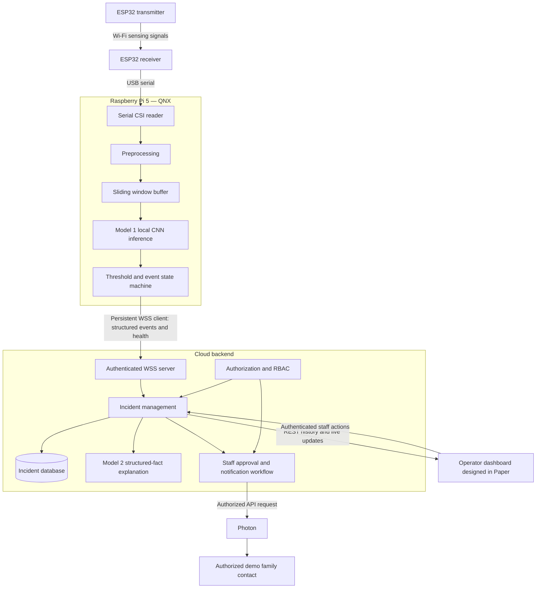

# Blissey Beacon — PROJECT_SPEC

Event: LA Hacks 2026. Last updated: 2026-10-17.
Document steward: Chloe (proposed); component owners review their contracts.
Status: authoritative implementation specification; application remains unimplemented.

**Confirmed** means selected in the complete team request, not proven operational.
**Proposed** means an implementation detail awaiting owner agreement. **TBD / Not
yet verified** means evidence or a decision is missing. Nothing described as a
planned component should be interpreted as working software.

## 1. Executive Summary

Blissey Beacon explores camera-free possible-fall detection for senior living
facilities. ESP32 Wi-Fi Channel State Information (CSI) feeds a supervised neural
network running locally on a Raspberry Pi 5 with QNX. Structured events travel over
WSS to a backend, where incidents appear on a caregiver dashboard, a second model
produces grounded explanations, and staff can approve authorized family contact
through Photon.

The MVP uses one room and one person with controlled staged falls and normal
movement. This is an experimental proof of concept, not a clinically validated
fall detector, medical diagnosis tool, or emergency response device. It is not
suitable for unsupervised medical safety monitoring.

The application repository was inspected before this revision. It contains
project documentation only; no trained model, implementation, or successful sponsor
integration is evidenced. Section 29 records the exact inspection limits.

## 2. Product Goals and Non-Goals

### Confirmed goals

- Detect temporal CSI patterns associated with staged falls without cameras or wearables.
- Keep Model 1 inference local on Pi/QNX and send structured events instead of raw CSI.
- Give operators immediate room alerts, health visibility, incident history, and response actions.
- Explain uncertain events factually and coordinate reviewed family notifications.
- Demonstrate an end-to-end MVP before pursuing stretch functionality.

### Confirmed scope

One ESP32 transmitter, one ESP32 receiver, one Pi 5 running QNX, one monitored room,
one person, one local neural network, one incident-explanation language model,
a cloud backend, an operator website, and one approved Photon notification flow.

Excluded: person identification, full-body pose, heart-rate/breathing estimation,
medical diagnosis, multiple-person tracking, validated cross-facility performance,
and automatic family calls without staff review and authorization. Multi-room
monitoring is stretch even though the UI should accommodate multiple room cards.

## 3. User Personas: Operators and Families

| Persona | Needs | Access boundary |
| --- | --- | --- |
| Senior-home operator | Facility room overview, offline-device counts, incident oversight and access management | Authorized facility and rooms only |
| Caregiver | Immediate possible-fall alert, room detail, acknowledgment, response, resolution and notes | Assigned rooms and staff permissions |
| Authorized family contact | Approved relevant updates and verified staff response information | Contact-specific call/message; no full operator dashboard |

Operators may inspect experimental scores, sensor health and incident timelines.
Families receive no raw CSI, technical fall scores, other residents' information,
or unreviewed clinical claims. Acknowledgment means staff saw the alert; it does
not establish injury, confirm a fall medically, or authorize a call.

## 4. Final System Architecture

The following transport and execution boundaries are **confirmed**.



Model 1 detects CSI patterns; the QNX service groups predictions into events;
the backend manages incidents; Model 2 explains facts. These are separate
responsibilities. The ESP32 receiver does not run Model 1 for the MVP.

## 5. Hardware and Network Architecture

Owner: Emilia for sensing and serial output; Chloe for Pi/QNX consumption.

| Link | Confirmed transport | Validation gate |
| --- | --- | --- |
| ESP32 TX → ESP32 RX | Wireless Wi-Fi radio signals for CSI sensing | Stable channel, firmware and reproducible placement |
| ESP32 RX → Pi | Direct USB serial using existing receiver output; not WebSocket | Actual baud, framing, USB driver and QNX device access |
| Pi → backend | Persistent secure WebSocket; Pi client, backend server | TLS, authentication, reconnects and durable event acknowledgments |
| Backend → Model 2 | Internal call or model inference API with structured facts | Schema and provider compatibility |
| Backend → frontend | REST history and authenticated real-time mechanism | Scoped subscriptions and reconnect recovery |
| Backend → Photon | API integration following authorization and review | Actual provider capabilities and consented test recipient |

Emilia must document board models, TX/RX roles, firmware revision, Wi-Fi channel,
CSI encoding, measured packet rate, serial baud, placement, height, participant
movement direction, room layout, and collection metadata. Preserve timestamps and
packet-integrity evidence. Do not infer sampling frequency or subcarrier count
from an ESP32 model name.

On serial loss or a long data gap, clear invalid temporal context, report degraded
sensing, and require a full valid window before inference resumes. Diagnose QNX
USB support first; a supported adapter or transport change needs team approval.
Do not silently replace USB serial, QNX, or local inference.

## 6. Technology Stack

No installed stack is evidenced. The training stack below is selected by the team;
other choices remain open rather than overriding an existing implementation.

| Layer | Decision | Status |
| --- | --- | --- |
| Sensing | ESP32 transmitter and receiver | Confirmed; boards/firmware TBD |
| Edge hardware/OS | Raspberry Pi 5, QNX | Confirmed; image/BSP/toolchain TBD |
| Model 1 training | Google Colab, Python, NumPy, TensorFlow/Keras, Scikit-learn | Confirmed; versions TBD |
| Model 1 baseline | Custom lightweight 1D CNN, random initialization | Confirmed; no pretrained checkpoint |
| Edge inference format | LiteRT/TensorFlow Lite if supported; ONNX alternative | Candidates; QNX runtime/operator support not yet verified |
| Cloud/backend/database | Existing stack if selected by team; none found in repository | TBD; no framework, database or host imposed |
| UI | Browser application to be implemented from Paper designs | Paper design role confirmed; frontend framework TBD |
| Model 2 | Small open-source instruction model; candidate `Qwen/Qwen2.5-0.5B-Instruct` | Proposed; Veri availability and serving compatibility TBD |
| Fine-tuning | Veri Studio, final path TBD | Planned; support and eligibility not yet verified |
| Family contact | Photon calling or messaging API | Planned; exact product/API/capabilities TBD |

Dependency versions, setup commands and deployment instructions must be added when
implementation selects actual tooling. Do not invent install/build commands now.

## 7. Dataset Format and Collection

Dataset: [emiluvu/bb-data](https://github.com/emiluvu/bb-data), separate from the
application. No dataset cloning or raw CSI download into this repository is
allowed. Colab may clone a pinned dataset revision into temporary runtime storage.

A read-only GitHub contents request on 2026-10-17 returned 404. This may reflect
access permissions or repository availability; its actual format remains **Not yet
verified**. No files, counts, license, labels, or hardware configuration were
inspected. Restore access before implementing the parser or labeling.

| Provisional file | Reported purpose | Must verify |
| --- | --- | --- |
| `measurements.jsonl` | CSI measurements and packet metadata | Keys, units, I/Q layout, timestamps, dimensions and malformed-record rules |
| `metadata.json` | Recording, participant, activity and configuration | Label vocabulary, grouping IDs, collection protocol and consent/provenance |
| `events.json` | Optional fall-event annotations | Timestamp/interval semantics, clock alignment and completeness |
| `raw_serial.bin` | Preserved serial output where available | Framing, encoding and relationship to parsed measurements |

| Category | Label evidence | Treatment |
| --- | --- | --- |
| Positive recording | Fall annotated with actual timestamps or intervals | Label selected windows using event timing, never the entire recording |
| Verified negative | Metadata or collection protocol confirms no fall | Valid windows may be negative even without `events.json` |
| Uncertain | Insufficient labels or contradictory annotations | Review; exclude from supervised training until resolved |
| Invalid | Corrupt data, unusable timing or incompatible layout | Exclude and report reason |

An absent `events.json` is expected for some negative recordings. Absence alone,
or an empty event file alone, is insufficient evidence of a negative label.

Emilia leads controlled collection; Chloe audits labels and usability. Audit
recording counts, durations, fall counts, activity balance, packet rates, feature
layouts, missingness, exclusions, and trial/session/participant groups. Use staged
events and fictional resident/room identifiers; no real resident data for the demo.

## 8. Model 1: Objectives and Training Method

Owner: Chloe; Chace collaborates on edge/backend interfaces.

**Confirmed:** supervised binary classification. Each example is a fixed-length
CSI window; target `0` is non-fall and `1` is fall from verified annotations.
Train using binary cross-entropy. This is neither reinforcement learning nor an
LLM or generative classification pipeline.

Train a lightweight temporal neural network in Colab and run continuous inference
on QNX. Model output is a sigmoid score, not a calibrated probability unless
calibration is evaluated. The baseline is trained from scratch; do not describe
randomly initialized CNN training as pretrained-model fine-tuning.

## 9. Model 1: Base Architecture

**Selected baseline:** custom Keras 1D CNN. It learns local temporal patterns across
CSI features while keeping the network small enough to investigate edge execution.
There is no initial pretrained checkpoint.

| Layer | Proposed starting architecture |
| --- | --- |
| Input | `[T, C]` per window; batch `[B, T, C]` |
| Temporal block 1 | Conv1D, 32 filters, kernel 5 → ReLU → MaxPooling1D |
| Temporal block 2 | Conv1D, 64 filters, kernel 3 → ReLU → MaxPooling1D |
| Aggregation | GlobalAveragePooling1D |
| Hidden layer | Dense 32, ReLU |
| Output | Dense 1, sigmoid → `fall_score` |

`T` depends on verified resampling rate and window duration; `C` depends on the
valid amplitude feature mask. Padding and pooling parameters remain configurable
and must be fixed in the model configuration after checking tensor dimensions
and QNX-supported operators. Do not assume this proposed topology has been trained
or benchmarked.

## 10. Sliding Window Preprocessing and Labeling

### Shared training/inference pipeline

Validate packet → parse verified I/Q layout → amplitude → mask invalid subcarriers
→ handle missing samples → align/resample time → normalize → fixed windows.
Training then assigns labels; live inference applies the saved model instead.

For verified complex CSI, `amplitude = sqrt(I² + Q²)`. Verify ordering, encoding,
invalid values and layout first. Use training-only normalization statistics in
all partitions and on QNX. Do not fit a fresh live scaler.

### Window definition and overlap

A single packet cannot show the temporal progression of a fall. A window collects
a fixed duration of measurements, and the stride controls how often another
prediction is made. Starting settings are three seconds and a 0.5-second stride.

At an **illustrative**, unconfirmed 100 Hz rate:

```text
Window 1: [0.0 s, 3.0 s)    300 timesteps
Window 2: [0.5 s, 3.5 s)    300 timesteps
Window 3: [1.0 s, 4.0 s)    300 timesteps
Window 4: [1.5 s, 4.5 s)    300 timesteps
Window 5: [2.0 s, 5.0 s)    300 timesteps
```

One input is `[300, C]`; a batch is `[batch_size, 300, C]`. These are dimensions
after alignment at the assumed rate, not a claim of actual collection frequency.
Overlap captures events crossing window boundaries and permits frequent updates,
but makes neighboring windows highly correlated. Split complete trial/session/
participant groups **before** generating windows; never randomly split overlapping
windows into training and evaluation sets.

### Proposed deterministic implementation rules

Use half-open windows `[start, end)` on the manifest's uniform time grid. At a
chosen rate `f`, require integer `T = duration * f` and integer stride samples;
otherwise explicitly define and save a rounding policy. Anchor the grid to each
recording start for training and a clean stream start for live inference.
Never join separate recordings, sessions, or data discontinuities into one window.

Freeze channel order/mask, resampling/interpolation method, maximum allowed gap,
valid-sample fraction, normalization, window/stride and grid policy in the manifest.
Small-gap interpolation is permitted only under that declared policy; long gaps,
corruption, nonfinite values or incompatible layouts invalidate the window.
Do not substitute zero-filled normal predictions. Reset temporal confirmation
when inference quality is invalid. Specific gap limits await dataset inspection.

### Labeling policy

Use actual fall intervals or point annotations on the same clock as the samples.
The policy and all boundary parameters must be configurable and selected before
final evaluation.

Proposed initial event-centered policy: a positive window contains the annotated
fall onset and enough configured pre/post-event context. Windows intersecting a
fall without sufficient context are ambiguous and excluded. For interval labels,
the team may instead select an explicit minimum-overlap criterion, saved in the
manifest; do not mix policies silently. An annotation containing only an onset
must not be given an invented end time. Exclude uncertain adjacent windows until
the annotation convention supports a defined boundary margin.

Verified negative recordings yield negative valid windows. Windows outside a fall
in a positive recording may be negative only where annotation completeness and
the configured exclusion margin establish normal activity. Uncertain recordings
remain excluded. A recording containing one fall is not positive at every moment.

### Live rolling buffer and event grouping

1. Read USB serial, validate and preprocess CSI using the frozen contract.
2. Append valid features to a bounded rolling buffer with monotonic timing.
3. Wait until a complete valid window exists; run Model 1.
4. Advance by the stride and repeat, retaining overlap.
5. Apply the temporal state machine to scores; transmit an event, not every score.

Proposed event states: `armed -> candidate -> triggered -> cooldown -> armed`.
Use a validation-selected threshold and persistence count; optionally use a lower
re-arm threshold with its own persistence. Emit one stable event ID per episode.
Continued high windows do not create repeated incidents. Re-arm only after the
configured reset condition and cooldown; invalid windows break confirmation.

Record `detected_at` when confirmation triggers. It is not exact physical onset.
An optional estimated onset requires a documented estimator and error evaluation.
Longer windows can capture more context but add startup/context latency and blur
timing. Shorter stride gives more frequent updates but increases correlated
predictions and compute. Higher thresholds/persistence can reduce false alarms
while missing events or delaying detection. Quantify these tradeoffs on validation
data rather than claiming exact fall timing from a window-level classifier.

## 11. Model Training and Evaluation

### Confirmed configurable starting values

| Parameter | Starting value |
| --- | --- |
| Window length / stride | 3 seconds / 0.5 seconds |
| Optimizer / learning rate | Adam / 0.001 |
| Loss | Binary cross-entropy |
| Batch size / maximum epochs | 32 / 30 |
| Early stopping | Validation loss; patience TBD |
| Input / output | CSI amplitude features / one sigmoid fall score |

Chloe pins seeds, dataset revision, split manifests, architecture, preprocessing
and training configuration. Use Scikit-learn for group-aware splitting, metrics
and simple baselines. Keep participant groups separate where possible; otherwise
use session/trial/recording groups and disclose generalization limits. Fit all
learned transforms on training only. Tune thresholds and persistence on validation;
freeze them before a final untouched test. Weighting or sampling for imbalance
must be recorded and confined to training.

| Metric | Reporting rule |
| --- | --- |
| Precision, recall, F1, confusion matrix | Window-level counts and class balance at a declared threshold |
| Event-level recall | Matched detected falls / annotated held-out falls; report missed falls |
| False alerts per monitoring hour | Unmatched alerts / verified normal monitoring hours |
| Detection latency | Trigger time minus annotated onset; report distribution and missed events separately |
| Event timestamp estimation error | Evaluate only if an onset estimator exists; otherwise mark not implemented |
| Runtime performance | QNX inference latency, end-to-end latency, memory and sustained throughput |

Proposed event matching: one detection per annotated fall within a declared timing
tolerance; specify that tolerance before testing. Extra unmatched episodes count
as false alerts, not additional true positives. Report observation duration, group
counts, exclusions, timing uncertainty and whether normal hours include downtime.

Evaluate sitting quickly, bending, crouching, intentional lying down, standing up,
walking, and background movement. No accuracy or false-alarm target has been
validated; agree numerical success targets after auditing available data. Report
untested rooms, people, placement changes and other limitations honestly.

## 12. Colab Training and Artifact Management

**Confirmed:** training runs in Google Colab, not on the Pi. No scripts or notebooks
are created and no training is started during this documentation task.

Planned workflow: clone the separate dataset into temporary Colab storage at a
pinned revision, inspect/audit, split groups, fit preprocessing on training, create
windows, train Keras CNN, tune on validation, evaluate held-out data, save the Keras
model and preprocessing, export, and compare predictions before transferring to QNX.

| Application repository may contain | Keep outside the application repository |
| --- | --- |
| Source, future training notebook/scripts, inference code, contracts, lightweight configs and reports | Raw CSI, duplicate archives, temporary tensors, large checkpoints and sensitive resident information |

Proposed artifact bundle: trained Keras model, embedded export, checksum manifest,
normalization statistics, feature mask/order, resampling policy, window/stride,
label policy, threshold/persistence/cooldown, seeds, dataset commit, split-manifest
hash, evaluation report and small approved parity fixtures. Record framework and
export/runtime versions, tensor dtype/layout, operator requirements and comparison
tolerance. Host large artifacts separately with versioned retrieval instructions;
host and access policy are TBD. Never commit dataset credentials or Colab tokens.

## 13. Veri Training/Fine-Tuning Integration

Sponsor challenge supplied by the team: **Best Use of an Open-sourced Model**,
requiring Veri post-training or fine-tuning of an open-source model. Actual current
eligibility and submission terms are **Not yet verified** with the sponsor.

The baseline CNN is trained from scratch in Colab. A custom CNN job is not inherently
post-training or fine-tuning a pretrained open-source model and must not be claimed
to satisfy the challenge automatically.

| Path | Investigation and acceptance evidence | Owner |
| --- | --- | --- |
| A: direct Model 1 integration | Verify custom PyTorch/TensorFlow scripts, non-LLM time-series support, from-scratch versus fine-tuning support, pretrained open-source time-series availability, CSI dataset support, checkpoint export and QNX compatibility | Chloe, with mentor confirmation |
| B: Model 2 SFT, recommended fallback | Verify an available open-source instruction model, training format, export/serving access and sponsor eligibility; compare base and fine-tuned model | Chace, with mentor confirmation |

Candidate for Path B: `Qwen/Qwen2.5-0.5B-Instruct`, subject to Veri availability,
license and compatibility verification. Use supervised fine-tuning examples pairing
structured possible-fall events with concise operator explanations, uncertainty,
approved notification wording, disconnected sensors, and negative/ambiguous events.
Do not teach the LLM to classify raw CSI.

Keep training and evaluation examples separate, including distinct incident
scenarios/templates. Compare base versus fine-tuned factual consistency,
unsupported medical claims, JSON validity, uncertainty language, clarity and
operator usefulness. Record model ID/revision, training settings, data provenance,
license, job evidence and evaluation. Approved wording in training data does not
authorize dispatch at runtime. **Final Veri path: TBD until compatibility and sponsor
requirements are verified.**

## 14. QNX Model Deployment and Inference

Owner: Chloe; Emilia supports serial integration. Use a verified QNX AI module
from the sponsor's eligible open-source catalog for actual inference. Catalog
module, eligibility, version and availability are TBD; none has been tested.

1. Save the trained Keras model and frozen preprocessing/configuration.
2. Export to LiteRT/TensorFlow Lite if supported; investigate ONNX otherwise.
3. Compare exported predictions against Keras on fixed held-out tensors using a
   declared tolerance; investigate label/threshold changes caused by conversion.
4. Confirm exact QNX image/BSP, hardware architecture, compiler/ABI, inference
   runtime, supported operators, USB driver, TLS/WSS and persistent storage.
5. Transfer versioned artifacts with checksums and reject incompatible manifests.
6. Load the model on actual Pi/QNX, reproduce golden outputs, measure resources
   and inference speed, then process live USB CSI into windows and events.

Prove serial reading and a representative neural forward pass early. Conversion
success alone does not prove QNX compatibility. A Linux desktop inference result
is not a QNX result. Changing export format must preserve the model task and
input contract. Startup/loading failure or missing data yields degraded monitoring,
not a fabricated normal score. Do not move the required inference into the cloud
or substitute Linux without an explicit team architecture decision.

## 15. Model 1 Output Schema

The neural network prediction interface contains one numerical score:

```json
{"fall_score": 0.91}
```

| Field | Contract |
| --- | --- |
| `fall_score` | Finite number in `[0, 1]`; sigmoid score, not assumed calibrated probability |

The QNX service owns thresholds, persistence, grouping, event IDs, timestamps,
device metadata, health and transport. A score alone is not an incident.

### Confirmed QNX → backend event schema v1

```json
{
  "event_id": "evt_102",
  "room_id": "room_102",
  "device_id": "pi_102",
  "event_type": "possible_fall",
  "fall_score": 0.91,
  "detected_at": "2026-10-17T14:32:06-07:00",
  "sensor_status": "connected"
}
```

| Required field | Contract |
| --- | --- |
| `event_id` | Unique nonempty string, stable across retries; no UUID-only requirement |
| `room_id` | Configured room ID, separate from device ID |
| `device_id` | Raspberry Pi ID, checked against authenticated connection |
| `event_type` | Initially exactly `possible_fall` |
| `fall_score` | Finite numeric value from 0 to 1 |
| `detected_at` | ISO 8601 detection-trigger timestamp with timezone; offsets and `Z` accepted |
| `sensor_status` | Sensor health string; `connected` for a valid detection; proposed other health states are `degraded` and `disconnected` |

`detected_at` is the confirmation trigger, not necessarily physical fall time.
Backend records a separate receipt time. Clock synchronization quality must be
operationally monitored; do not promise precise onset when the clock is uncertain.

Future optional fields are `estimated_fall_at`, `post_event_motion`, `model_version`,
`sensor_quality`, and `inference_latency_ms`. None is a required v1 field. No extra
`type`, `schema_version`, UUID, boot ID, window timestamps, or model version is
required for accepting a conforming seven-field v1 event. Negotiate future breaking
schema revisions explicitly rather than changing the contract silently.

## 16. WebSocket Protocol and Backend Ingestion

Owners: Chloe (client), Chace (server). Required: persistent WSS, device
authentication, validation, event-ID deduplication and periodic health. The policies
below are proposed implementation details for their agreement.

| Concern | Proposed policy |
| --- | --- |
| Endpoint/version | `wss://<backend>/api/devices/v1/stream`; version selected by route, no additional required event fields |
| Authentication | Scoped revocable device credential in handshake authorization header; verify TLS certificates; never put credentials in URLs |
| Room mapping | Server maps credential to device and room; reject a mismatched payload identity |
| Retry | Full-jitter exponential backoff from 1 to 30 seconds; credential rejection needs reprovisioning rather than a retry loop |
| Health | Every 10 seconds; stale after 30 seconds without accepted health; track sensing faults separately from socket liveness |
| Bounds | Proposed 16 KiB message maximum and bounded parsing/logging |
| Event delivery | Persist local outbox before send, remove only after durable backend ACK; at-least-once delivery with deduplication |
| Outbox | Proposed bounds: 1,000 events or 24 hours; expiration/overflow visibly increments loss counters; QNX persistence must be verified |
| Backend commit | Atomically store event and incident before ACK; duplicate same payload returns same incident; conflicting ID reuse is rejected |

Deduplicate using globally unique `event_id`, also recording authenticated device
ownership. Reject an event ID reused by another device or with changed facts.
Do not create repeated incidents or notifications on retransmission. Retain
observed detection and receipt timestamps for delayed/out-of-order events; delayed
incidents still require fresh staff review.

Proposed ACK (a separate backend response, not an added inference-event requirement):

```json
{"type":"event_ack","event_id":"evt_102","incident_id":"inc_102","status":"accepted"}
```

Duplicate ACK uses `status: "duplicate"`. Proposed rejection:

```json
{"type":"error","event_id":"evt_102","code":"invalid_payload","retryable":false}
```

Validate required fields, lengths, timestamp parsing, finite scores and identity.
Retry transient storage/availability errors; do not endlessly retry malformed
payloads. Lost ACKs cause retransmission of the same event ID. A database failure
must not produce a successful ACK. After a backend restart, durable deduplication
still applies. Local inference continues offline within storage/resource limits.

Proposed distinct health message, distinguishable from events by `type`:

```json
{
  "type": "device_health",
  "device_id": "pi_102",
  "room_id": "room_102",
  "sent_at": "2026-10-17T14:32:10-07:00",
  "sensor_status": "connected",
  "model_status": "ready",
  "last_valid_frame_at": "2026-10-17T14:32:10-07:00",
  "outbox_depth": 0,
  "dropped_event_count": 0,
  "clock_synced": true
}
```

This health schema is proposed and independent of event v1. `last_valid_frame_at`
is nullable before valid input. Proposed model states: `loading|ready|error`.
Use ping/pong for transport liveness, but do not equate a live socket with working
sensing. Backend derives room monitoring state from receipt age, serial health and
model readiness. Preserve faults in UI and diagnostics.

## 17. Model 2: Base Model, Training, Input/Output

Owner: Chace. Model 2 transforms structured facts into human-readable incident
interpretation; it never sees raw CSI. Proposed open-source base model:
`Qwen/Qwen2.5-0.5B-Instruct`, contingent on Veri and deployment compatibility.
Serving location/API and final model choice are TBD. Optional Veri SFT follows
Section 13. Text generation and speech synthesis are separate components.

Backend enriches the event with the database room label, incident status, audience
and other authorized verified context. Operator input example:

```json
{
  "event_id": "evt_102",
  "event_type": "possible_fall",
  "room_label": "Room 102",
  "detected_at": "2026-10-17T14:32:06-07:00",
  "fall_score": 0.91,
  "sensor_status": "connected",
  "audience": "operator"
}
```

Stable output contract:

```json
{
  "event_id": "evt_102",
  "title": "Possible Fall Detected",
  "description": "A possible fall was detected in Room 102 at 2:32 PM.",
  "recommended_action": "Check on the resident in Room 102."
}
```

| Field | Validation responsibility |
| --- | --- |
| Input event ID and facts | Backend supplies stored validated facts, not arbitrary client text |
| `audience` | `operator` or `family`; backend applies audience-specific allowlist |
| Output `event_id` | Must match the input |
| `title`, `description`, `recommended_action` | Required bounded strings; proposed limits 120/800/300 characters |
| Clinical and response claims | Reject unsupported injury, diagnosis, confirmed-fall or invented staff-response assertions |

For family generation omit the technical score and use only approved authorized
context. Do not include phone numbers, other residents, credentials, or unnecessary
personal data in model inputs. Staff notes are data, not prompt instructions.
Store model/prompt version and input hash alongside output for traceability.

Proposed execution: asynchronous generation after incident persistence, five-second
timeout, at most one transient retry, schema/fact checks, then deterministic text.
Fallback uses the same four-field output shape and cautious wording. Show incident
immediately with explanation status `pending|ready|fallback`; generation failure
must not block alerting, acknowledgment, resolution, or required staff review.
No generated text independently authorizes dispatch or confirms a medical state.

## 18. Backend and Database

Owner: Chace / Backend Team; Chace is the lead. Framework, database and host are
TBD because no implementation or selected stack was found. Use an existing team
selection if one is confirmed; do not introduce a competing stack.

Backend owns authenticated WSS ingestion, schema validation, deduplication,
persistence, room/device mappings, lifecycle, Model 2 orchestration, scoped REST
and live updates, reviewed Photon jobs and audits.

| Logical entity | Minimum information/invariant |
| --- | --- |
| Facility / Room | Separate IDs, facility membership and display labels |
| Device | Separate device ID, configured room assignment, credential reference, last health |
| User / staff scope | Auth subject, role and facility/room membership |
| InferenceEvent | Unique event ID, device ownership, validated payload/hash, detection and receipt times |
| Incident | Incident ID, event reference, room, status, revision, lifecycle actors/timestamps, disposition and notes |
| Explanation | Incident, output, generation status, model/prompt version and input hash |
| FamilyContact / consent | Authorized relationship, private destination, scope, grant/revocation evidence |
| Notification | Incident/contact, approval, exact approved text, idempotency key, provider ID/status |
| Audit | Actor/device, action, scoped target, timestamp and outcome without secrets |

Proposed incident lifecycle: `pending -> acknowledged -> responding -> resolved`.
Each transition records actor/time and validates current revision. Staff can mark
false alarm as a separate resolution outcome, not as a synonym for acknowledgment.
Proposed outcomes: `reported_fall`, `false_alarm`, `unknown`; a staff report is not
clinical validation. Define any skipped-state transitions explicitly before API
implementation; default proposal rejects skipping states. Notes are bounded and
audited. Resolved incidents remain in history; reopening is TBD, not implicit.

Persist incidents before explanation generation and publish live updates only
after commit. Use transactional state changes and durable uniqueness for retries.
Notification state remains independent from incident state (Section 20).

## 19. Operator Dashboard

Primary owner: Kiro / Frontend Team. Paper is the design tool; the actual frontend
must be implemented and connected to backend APIs. No Paper design artifact or
application is evidenced yet. Record the design link and implementation handoff
when available.

| View | Required content/actions |
| --- | --- |
| Facility overview | All authorized monitored rooms, room identifier, monitoring and active incident state, connection health, last data time, acknowledgment, attention-room and offline-device counts |
| Room detail | Room label/ID, assigned device ID, connection and monitoring state, possible-fall detections, detection timestamp, experimental score, verified recent activity, timeline, acknowledgment, resolution and history |
| Incident actions | Acknowledge, mark responding, resolve, mark false alarm, add notes and approve authorized family notification |
| Optional technical view | Reduced CSI visualization, quality/packet diagnostics and inference latency only if available |

“Recent activity” must use observed events/health, not invented activity recognition.
Label detection time as trigger time; display estimated physical onset only when
an estimator exists. Keep room and device identifiers separate. Display offline or
degraded monitoring when sensing fails, never a safe-room state. Technical CSI
visualization does not authorize full raw CSI cloud streaming.

Include loading, empty, error, stale/offline, degraded sensing, generation fallback,
concurrent-edit and notification-failure states. Display stale data until refetch
succeeds after reconnect. Use accessible text/icons as well as color and accessible
focus behavior. Multiple-room fixtures test layout without claiming multi-room sensing.

## 20. Family Notifications and Photon

Photon integration owner: **TBD**. Chace owns backend authorization/orchestration;
a named Photon lead must own provider integration and authorized live testing.
Exact Photon product, calling, messaging, TTS, webhook and status capabilities
are **Not yet verified**. Do not document them as working.

Confirmed flow: detection → operator alert → caregiver review → staff approves
contact → backend generates approved message → Photon call/message → status stored.
Never call family for every positive window or model prediction.

Proposed concrete workflow:

1. Staff selects an authorized contact and reviews relevant incident/response facts.
2. Backend generates a draft from approved context; staff reviews exact recipient
   and final wording before dispatch. New text or recipient changes require review.
3. Backend verifies staff scope, active contact authorization/consent, current
   incident revision and approval. Verified follow-up updates after resolution may
   be eligible; resolution alone never authorizes or forbids contact.
4. Atomically store approval and a durable notification job; recheck consent and
   approval freshness immediately before submitting to Photon.
5. Submit using server-held credentials and an idempotency key if supported. Persist
   provider ID/status and show failure or uncertainty to staff.
6. Verify webhook signatures and deduplicate callbacks if the provider supports
   them; otherwise use its verified status mechanism. Never invent delivery evidence.

Proposed states: `pending_review -> queued -> sending -> accepted -> delivered`,
with `cancelled`, `failed` and `unknown` alternatives. `accepted` means provider
acceptance, not answered/read/delivered. Expose `delivered` only when provider
evidence supports it. On ambiguous submission, reconcile status or flag `unknown`;
do not blindly retry a call that may already have happened. Consent revocation
cancels unsent work. Already submitted work may not be retractable; record that fact.

Family payload contains approved incident updates, verified staff response and
authorized follow-up only. Exclude scores, raw CSI, other residents and unsupported
clinical claims. Use fictional residents and consented demo contacts. Photon outage
preserves approved payload and status for staff; a mock never proves a real call.

## 21. Team Roles and Component Ownership

Assignments below are confirmed by the complete request, except explicit TBDs.

| Person | Primary ownership | Deliverables / handoff |
| --- | --- | --- |
| Emilia | Hardware and CSI collection | Working TX/RX, reproducible configuration, timestamped serial stream, recordings and schema evidence to Chloe |
| Chloe | Model 1 and edge inference | Parsing/preprocessing, CNN training, evaluation, artifacts, QNX runtime, event-producing WSS client |
| Chace | Model 2 and backend | Grounded explanations, optional Veri SFT, authenticated WSS server, persistence, APIs and notification authorization |
| Kiro / Frontend Team | Operator interface | Paper design, implemented room dashboard/detail, incident actions and backend integration |
| TBD | Photon provider integration | Exact API/capability verification, consented recipient, dispatch/status adapter and live test |
| Entire team | Integration, testing and presentation | End-to-end evidence, honest limitations and demo rehearsal; integration lead TBD |

Boundary leads: Emilia ensures serial output works; Chloe consumes it using the
verified packet contract; Chace implements the receiving event service and API;
Kiro consumes those APIs; Chace's Model 2 receives structured facts only. Chloe and
Chace jointly review event contracts, with Chace leading backend acceptance. A
shared task must have one named lead; “entire team” is not a substitute for assigning
Photon or an integration coordinator.

## 22. Sponsor/Track Integration

All mapping is planned from team intent. Current working integration, verified
eligibility and completed submission requirements are **Not yet verified** for
every row. Tool use alone does not establish prize eligibility.

| Track/sponsor | Planned contribution | Evidence needed |
| --- | --- | --- |
| Model Learning | Supervised learning on real CSI and quantitative neural evaluation | Dataset provenance, reproducible model and held-out metrics |
| Beyond the Digital | Physical Wi-Fi sensing and local inference | Live hardware-to-edge demo |
| Applied Intelligence | Caregiver monitoring and response workflow | Integrated product demonstration and limitations |
| Espressif | ESP32 as core sensing hardware | Board/firmware evidence and live CSI collection |
| QNX | Pi/QNX inference using an eligible open-source AI module | Catalog/module eligibility confirmation and actual QNX inference logs |
| Veri Studio | Post-training/fine-tuning through a compatible verified path | Mentor-approved path, open-source base/license, Veri job and comparative evaluation |
| Paper | Operator dashboard design | Paper artifact and corresponding implemented UI |
| Photon | Reviewed authorized family contact | API verification and real consented call/message status |

For each sponsor, separately record planned use, working integration, verified
eligibility, and completed submission artifacts. Mentor confirmation must cover
current rules, eligible modules/models, attribution, licenses and required evidence.
No current sponsor website rules or supported-model catalog were verified here.

## 23. API Contracts

The following routes are the team's **proposed API**, not implemented endpoints.
Chace finalizes bodies/auth with Kiro before implementation. Avoid competing route
names from the earlier partial draft.

| Method/path | Behavior |
| --- | --- |
| `GET /api/operator/rooms` | Authorized room summaries, health, incident and attention counts |
| `GET /api/operator/rooms/:id` | Scoped room/device detail and recent incident references |
| `GET /api/operator/incidents` | Filtered scoped history; proposed cursor pagination, default 25/max 100 |
| `GET /api/operator/incidents/:id` | Facts, lifecycle, explanation, notes and allowed notification history |
| `PATCH /api/operator/incidents/:id` | Validated staff state transition, disposition or note |
| `GET /api/devices/status` | Authorized staff device/serial/model/network health |
| `POST /api/operator/incidents/:id/notifications` | Proposed extension for final reviewed dispatch |
| `GET /api/operator/stream` | Proposed authenticated WebSocket upgrade for live updates |

Proposed mutation example:

```json
{"expected_revision":2,"status":"responding","note":"Caregiver heading to room."}
```

Require authenticated staff, scoped object access, allowed state transition,
optimistic revision check, audit and idempotency for mutations. A retry must not
duplicate a note or notification. A successful incident response includes ID, room,
status, revision, detection/receipt times, explanation status and allowed actions;
final detailed response schemas remain proposed and require Chace/Kiro agreement.

Proposed error envelope:

```json
{"error":{"code":"state_conflict","message":"Incident changed; refresh before retrying.","request_id":"opaque-id"}}
```

Use `400` invalid payload, `401` unauthenticated, `403` forbidden, `404` absent or
concealed cross-scope object, `409` revision/state conflict, `429` rate limit and
`503` transient outage. Never expose credentials or private contact destinations
in errors. Proposed live updates carry update ID, entity ID, type and revision
following commit; browser ignores older revisions. Reconnect refetches REST
snapshots/history; durable live-message replay is not promised for MVP.

## 24. Privacy, Safety and Security

| Principal | Proposed enforced permissions |
| --- | --- |
| Device | Submit its own events/health; receive its own acknowledgments |
| Caregiver | Assigned rooms, incident actions and approved contact workflow |
| Operator/admin | Facility-scoped device/room/staff/contact configuration and audit |
| Family | Receive authorized approved contact only; no operator dashboard access |

Enforce scope on every REST object and live subscription on the server, never only
in the UI. Protect user sessions and CSRF-sensitive cookie mutations. Use WSS/TLS,
revocable device credentials and deployment secret storage; redact tokens/contact
numbers from logs. Persist incident and notification approval trails. CSI remains
sensitive movement data even without cameras.

Demo uses staged events and fictional residents/rooms, never actual resident data.
Use verified consented demo contacts. Separate family and operator DTOs; family
inputs/outputs exclude experimental scores and technical diagnostics. No component
may invent resident condition or imply emergency services were contacted.

Retention is TBD with team approval. Proposed demo backend retention: seven days
for events, explanations, incidents, notification records and audit, followed by
deletion of derived copies; confirm audit needs, backups and host expiry before
adoption. Dataset permissions/retention and Model 2 provider retention are separate
verification items. No production compliance or clinical safety claim is made.

Failure recovery must expose sensing loss, stale UI, unavailable models, queued
undelivered events and notification uncertainty. A disconnected sensor is not
evidence of safety, and lack of an alert is not proof no fall occurred.

## 25. MVP Acceptance Criteria

All criteria below are **Unverified**; no implementation evidence exists. Dataset
inspection is **Blocked** by the observed access failure. No criterion is marked
implemented or partial merely because this specification describes it.

| # | Required demo evidence | Owner |
| --- | --- | --- |
| 1 | ESP32 TX generates sensing traffic | Emilia |
| 2 | ESP32 RX captures CSI | Emilia |
| 3 | CSI reaches Pi through direct USB serial | Emilia + Chloe; Chloe leads Pi validation |
| 4 | Raspberry Pi demonstrably runs QNX | Chloe |
| 5 | QNX preprocesses live CSI identically to training | Chloe |
| 6 | Model 1 performs local inference | Chloe |
| 7 | Temporal logic produces a possible-fall event | Chloe |
| 8 | Pi sends confirmed v1 event through WSS | Chloe + Chace; Chace leads ingestion validation |
| 9 | Backend durably persists the incident exactly once | Chace |
| 10 | Dashboard displays the incident | Kiro |
| 11 | Operator acknowledges and resolves; responding/false-alarm actions work | Kiro + Chace; Kiro leads UI validation |
| 12 | Model 2 produces a grounded explanation with safe fallback | Chace |
| 13 | Staff-approved Photon contact succeeds to an authorized demo recipient | Photon lead TBD |

P1 roadmap classification of explanations/Photon does not remove criteria 12–13
from the complete MVP demonstration. Veri eligibility is tracked separately from
core product functionality. A mock, replay or deterministic template must be
labeled and cannot establish a live integration it replaces.

## 26. Testing and Validation

No test tooling or runnable build/train/test commands are present. These are
planned checks, not tests executed by this task.

| Layer | Planned meaningful checks |
| --- | --- |
| Data/Model 1 | Held-out trials, difficult negatives, missing-event negative/unknown semantics, no split leakage, normalization/window parity, precision/recall/F1/confusion matrix, event recall, false alerts/hour and latency |
| Hardware | TX/RX stability, packet integrity, measured sample rate, sustained capture, USB disconnect/reconnect and timestamp continuity |
| QNX | Model load, operator compatibility, Keras/export/QNX output comparison, memory, inference time and sustained real-time windows |
| Backend | Authenticated WSS, malformed messages, duplicate/conflicting IDs, lost ACKs, reconnect/restart, incident persistence, lifecycle concurrency, Model 2 outage and notification authorization |
| Frontend | Multiple fixture room cards, detail navigation, live/stale/offline states, acknowledgment/responding/resolution, false alarm, notes and conflict recovery |
| Notifications | Unauthorized/revoked contact rejection, content re-review, idempotency, provider outage, ambiguous submit and duplicate callbacks if supported |
| Security | Cross-room/facility REST and stream denial, device identity mismatch, family exclusion from staff actions, secret redaction |

Full-system rehearsal: normal movement produces no alert in the tested trial;
a controlled staged fall yields local QNX inference, WSS event, persisted incident,
dashboard update, grounded explanation, staff review/approval and Photon delivery
evidence. Record false alerts and misses from broader evaluation; one successful
rehearsal is not an accuracy guarantee. Exercise serial/backend/LLM/Photon outages
and recoveries, marking real hardware versus synthetic fixture evidence.

Proposed engineering latency target: incident visible within five seconds of edge
trigger on a healthy network, excluding collection window and asynchronous LLM.
Agree target with the team before acceptance use. Report p50/p95 stage latencies,
observed duration, hardware/software versions and limitations.

## 27. Risks and Fallbacks

| Risk | Explicit fallback and limit |
| --- | --- |
| Insufficient labeled CSI | Collect more controlled trials; temporary feature-based classifier for pipeline diagnosis, clearly labeled; it does not satisfy required neural-model MVP |
| Veri cannot fine-tune/export CSI CNN | Keep Model 1 in Colab; investigate Model 2 SFT through Veri; eligibility remains unverified until confirmed |
| LiteRT/TFLite unsupported on QNX | Investigate supported ONNX runtime/export and operators; preserve input/task contract and verify output parity |
| QNX USB driver unavailable | Diagnose support, then seek team-approved adapter/transport change; no silent architecture replacement |
| Model 2 unavailable | Persist/show incidents immediately and use deterministic same-schema explanation; do not claim the LLM ran |
| Photon unavailable | Preserve approved payload and status, demonstrate review workflow, disclose no real call/message occurred |
| Poor live performance | Report actual results and collect better data; use clearly labeled recorded replay for fallback presentation, never as live evidence |
| Backend/network outage | Continue local inference and bounded outbox; reconnect/retry stable IDs; expose losses and stale monitoring |
| Ambiguous Photon result | Reconcile via supported status/idempotency mechanism or flag unknown; avoid duplicate calls |

Export feasibility and serial access are early critical-path gates. Stretch features
must not consume time needed to prove local sensing, durable incidents and reviewed
contact. No fallback justifies unsupported medical or sponsor-success claims.

## 28. Implementation Roadmap

Priorities below follow the team's supplied order. Some P1 work remains mandatory
for the full MVP acceptance; prioritize core infrastructure first, then finish the
required explanation and notification flow before claiming the complete MVP.

| Priority | Work | Exit evidence |
| --- | --- | --- |
| P0 | Reliable CSI capture and data pipeline | Verified source schema/labels, reproducible TX/RX/serial settings and clean windows |
| P0 | CNN training and evaluation | Group-aware splits, baseline training, honest held-out report and versioned artifacts |
| P0 | QNX inference | Verified eligible runtime, real USB windows and output parity on Pi/QNX |
| P0 | WSS transport and incident backend | Auth, validation, deduplication, persistence, health and recovery |
| P0 | Operator dashboard and acknowledgment | Room overview/detail and integrated incident lifecycle |
| P1 | Veri fine-tuning | Compatible mentor-confirmed path with base/SFT comparison and sponsor evidence |
| P1 | Model 2 and Photon | Grounded explanations plus authorized reviewed live notification |
| P1 | Health/history product extensions | Basic health is required from P0; richer diagnostics and history follow |
| P2 | Stretch | Multi-room sensing, personalized calibration, additional models, reviewed staff-feedback retraining and advanced activity interpretation |

### Five highest-priority engineering tasks

1. Emilia and Chloe restore dataset access, inspect actual packets/annotations and
   prove reproducible TX/RX USB serial capture on QNX.
2. Chloe proves a compatible eligible QNX inference module with representative CNN
   operators, then builds a frozen preprocessing/window contract with Keras parity.
3. Chloe trains/evaluates the configurable Colab baseline using group-aware splits
   and exports versioned model/configuration artifacts.
4. Chace implements the confirmed seven-field event ingestion with authentication,
   durable deduplication, incident lifecycle, health and agreed frontend APIs.
5. Kiro integrates the Paper-designed room/incident UI; Chace and the named Photon
   lead complete explanations and staff-reviewed contact for end-to-end rehearsal.

Synthetic contract fixtures can unblock backend/UI work while hardware/ML work
progresses. Label all fixture/replay/live sources and validate the real path before
presentation. Assign Photon and integration leads immediately.

## 29. Current Repository Implementation Status

Inspection baseline for application source: `8aa999b1047197c01b8813d917429e43ff66b860`.
Prior specification commit: `b428a4d`. Current revision inspects the local
`docs/project-spec` branch; no application source appeared after the baseline.
The earlier connected GitHub main-branch read matched the baseline; this is not a
claim of continuous remote synchronization.

| Existing relative path | Observed evidence |
| --- | --- |
| [README.md](README.md) | Project overview, setup placeholders and spec-change process |
| [CONTRIBUTING.md](CONTRIBUTING.md) | Branch/PR workflow, Conventional Commits and validation expectations |
| [AGENTS.md](AGENTS.md) | Repository working instructions |
| [SPEC.md](SPEC.md) | Compatibility pointer to this canonical specification |
| [PROJECT_SPEC.md](PROJECT_SPEC.md) | This architecture/planning document; not implementation evidence |

| Component | Status from repository evidence |
| --- | --- |
| Firmware, CSI parser, collection code | Not implemented in this repository; external hardware work not yet verified |
| Dataset schema/content | Blocked from inspection: GitHub contents returned 404; no clone/download |
| Training notebooks/scripts, checkpoints, evaluation | Not present; no training/evaluation claimed |
| QNX service, runtime module, exported model | Not present; compatibility and deployment not yet verified |
| WSS/REST backend, database, auth, Model 2 | Not present |
| Paper artifact and integrated frontend | Not present |
| Veri job, Photon adapter/live delivery | Not present; not yet verified externally |
| Dependency manifests, CI/build/test tooling | Not present; no application checks can be run |

This task changes documentation only. It creates no feature code, training script,
model, dataset, notification or deployment. Unrelated local `.DS_Store` remains
excluded. No fabricated source paths are offered as implementation evidence.

## 30. Open Questions and Decisions

| Decision/evidence needed | Lead / confirmation |
| --- | --- |
| Dataset access, exact schema, annotation clock/interval conventions, counts, license and participant permission | Chloe + Emilia |
| Real sample rate/feature count, gap handling, labeling margins, split groups and final quality targets | Chloe |
| QNX image/BSP, USB driver, compiler/ABI, eligible catalog AI module and required operators | Chloe + QNX mentor |
| LiteRT/TFLite versus ONNX and artifact host/checksum/configuration format | Chloe |
| Veri custom CNN compatibility or Model 2 SFT, candidate availability, licenses, challenge rules and submission evidence | Chloe/Chace + Veri mentor |
| Backend framework/database/hosting/auth, API bodies, health policy and concurrency details | Chace + Kiro |
| Model 2 serving/model revision, privacy/retention, exact prompt and evaluation set | Chace |
| Paper design access/link and frontend framework | Kiro |
| Photon lead, exact provider/API, calling/messaging/TTS, delivery evidence and idempotency | Team assigns lead + Photon mentor |
| Integration coordinator, deadlines, consented recipient, final demo retention and deletion process | Entire team; lead TBD |

Do not reopen confirmed architecture, named ownership or selected Keras baseline
as if they were unspecified. Mentor-dependent compatibility remains TBD until
documented evidence supports a decision.

## 31. Architecture Decision Log

| ID / date | Decision and status | Rationale / supersession |
| --- | --- | --- |
| ADR-001 / 2026-10-17 | Confirmed: RX → Pi direct USB serial; Pi/QNX local inference; Pi client → cloud server via WSS | Team architecture; raw CSI cloud streaming excluded from MVP |
| ADR-002 / 2026-10-17 | Confirmed: Colab supervised binary Keras CNN from random weights, BCE loss, configurable starting hyperparameters | Complete request replaces partial draft's unspecified framework/training defaults; not pretrained fine-tuning |
| ADR-003 / 2026-10-17 | Confirmed: missing event file can represent a verified negative; unknown labels excluded | Actual timing determines window labels; recording-level fall does not label every window positive |
| ADR-004 / 2026-10-17 | Confirmed: seven-field event v1 in Section 15 | Supersedes partial draft's `p_fall`, `event_kind`, mandatory UUID/envelope/version/window fields; extensions remain optional |
| ADR-005 / 2026-10-17 | Proposed: `pending → acknowledged → responding → resolved` and `/api/operator/...` routes | Complete request supersedes earlier proposed `open → acknowledged → resolved` and `/v1/...` REST routes; owners finalize bodies |
| ADR-006 / 2026-10-17 | Confirmed Model 2 example contract: event ID, title, description, recommended action | Supersedes partial draft's proposed summary/limitations output; raw CSI never supplied |
| ADR-007 / 2026-10-17 | Confirmed named owners: Emilia hardware, Chloe Model 1/QNX, Chace backend/Model 2, Kiro frontend; Photon TBD | Complete request replaces unassigned role placeholders |
| ADR-008 / 2026-10-17 | Planned Veri Path A investigation; Path B Model 2 SFT fallback; final path TBD | Custom CNN training alone does not prove fine-tuning prize qualification |
| ADR-009 / 2026-10-17 | Confirmed staff-reviewed authorized Photon contact and separate family/operator information | Scores/CSI remain operator-only; acknowledgement or generation never substitutes for approval |
| ADR-010 / 2026-10-17 | Confirmed complete-request structure and P0/P1/P2 order; full MVP includes explanations and Photon despite P1 sequencing | Supersedes truncated-request caveat and earlier all-P0 extension classification; no completion claim |

The complete user request explicitly authorizes this specification revision and
supersedes conflicting earlier proposals. Only `PROJECT_SPEC.md` is changed in
this revision, following its one-primary-file deliverable; this log records the
previous/revised decisions and reasons within that file. It does not claim team
acceptance of details still labeled proposed.

## 32. How to Maintain This Specification

Use this file as the authoritative architectural reference; [SPEC.md](SPEC.md)
remains a compatibility entrypoint. Follow [CONTRIBUTING.md](CONTRIBUTING.md) and
[README.md](README.md) for review, branch/PR, specification approval and commit
workflow. Update last-updated date and steward/owner information with changes.

1. Inspect current source before editing. Preserve verified implementation facts
   and useful team decisions; cite existing relative source paths for working code.
2. Distinguish confirmed intent, proposed details, working integration, verified
   eligibility and completed submissions. Mark unresolved facts TBD or Not yet verified.
3. For work contradicting this spec, propose affected sections and a timestamped
   delta with previous/revised requirements and rationale; obtain the explicit
   approval required by README before conflicting edits or implementation. After
   approval, update the spec, delta and architecture decision log together.
4. Have boundary owners agree interfaces before dependent implementation. Record
   changed schema versions and migration/compatibility decisions; do not silently
   add required event v1 fields.
5. Update repository/acceptance status only with evidence: source paths, dataset
   commit, hardware/runtime versions, training/evaluation reports or verified live
   integration records. Never claim success merely from a plan or mock.
6. Keep datasets and large artifacts separate; never add secrets or sensitive
   resident information. Preserve the shared training/inference preprocessing
   contract and audit trail as models change.
7. Run appropriate checks and record limitations. Keep this document focused on
   actionable decisions and honest evidence under hackathon constraints.
