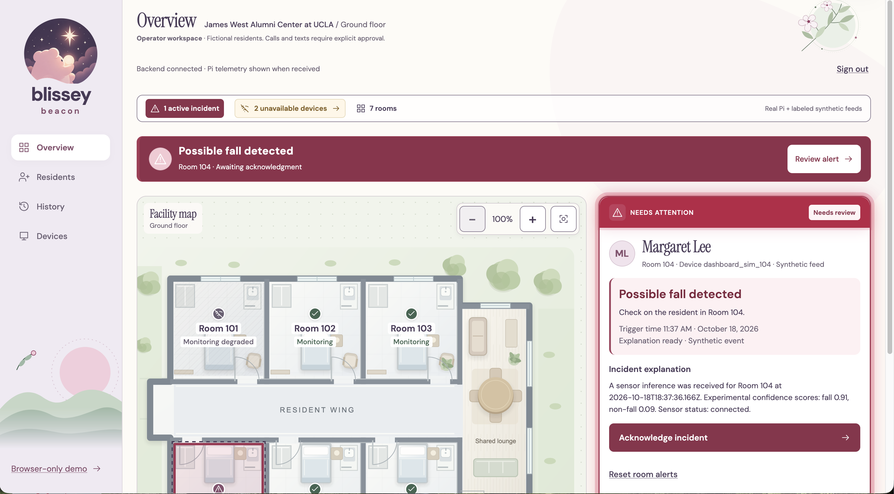
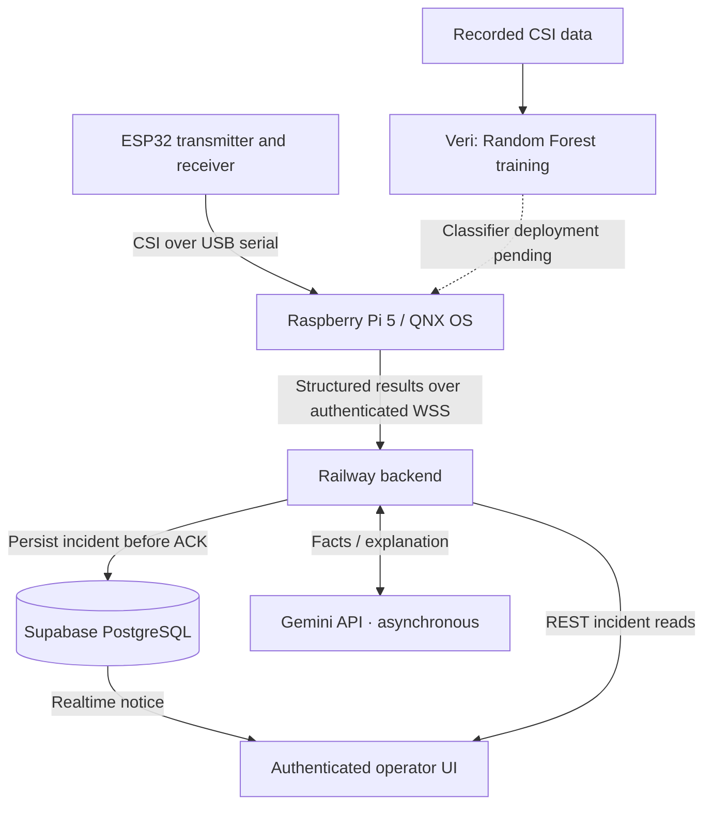
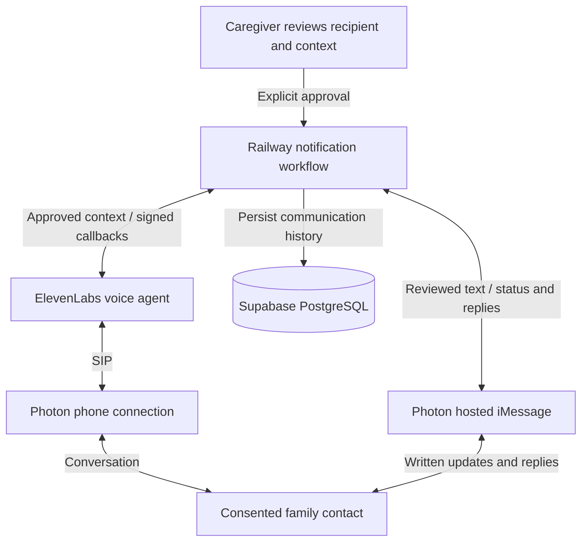

# Blissey Beacon

**Camera-free monitoring. Clearer alerts. Connected families.**

Blissey Beacon is an experimental senior-care monitoring system that uses Wi-Fi
sensing to explore possible-fall detection without cameras or wearables. It brings
room activity, incident review, and family communication into one caregiver
experience.

Built for **LA Hacks 2026 · Beyond the Digital**.

**[Explore the interactive demo →](https://blissey-beacon.health/?demo=1)**



*Connected operator dashboard showing a synthetic possible-fall alert in Room 104.
Resident records are fictional; calls and texts require explicit operator approval.*

## Why we built it

Caregivers need useful information when something might be wrong. Families need
clear updates. Residents deserve privacy.

Blissey Beacon explores a less intrusive approach: sense changes in Wi-Fi signals,
surface possible incidents for caregiver review, and help staff communicate with
authorized family contacts. The caregiver stays in control of incident response
and notification approval.

## From sensing to family updates

The data path separates offline training, edge sensing and cloud incident
processing. The team has integrated QNX sensing/transport and its inference
runtime; classifier deployment/parity and the complete physical sensing flow
remain under validation.



QNX collects ESP32 sensing data and securely sends results to the backend.
We integrated QNX's `python3-tflite-runtime` from [oss.qnx.com](https://oss.qnx.com/)
to support local fall-detection inference. Random Forest export and prediction
parity with the QNX deployment still need validation; the runtime's presence is
not evidence that the trained forest executes through it.

Veri is used for offline training. Raw CSI stays local at runtime, and Gemini
receives only structured incident facts. Incidents are persisted and published
before explanations finish. The dashboard preserves a browser-only fixture mode at `/?demo=1`. Its authenticated
workspace now connects scenarios and incident actions to the existing backend;
see the [connected dashboard guide](docs/connected-dashboard.md) for configuration and verification limits.

### Reviewed family communication



Voice and messaging have separate consent and authorization. iMessage follows the
backend-to-Photon path, independently of ElevenLabs. Call callbacks and polled
message replies return through the backend and are stored against the incident;
authenticated operators can view call, message and reply history in the family notification review.
The provider tests used synthetic incidents and consented recipients, separately
from the public fixture demo.

### How it works

1. **Sense movement.** ESP32 boards capture Wi-Fi Channel State Information (CSI),
   measuring how movement changes the wireless channel.
2. **Process at the edge.** QNX OS on a Raspberry Pi 5 collects sensing data and
   securely transmits results. Veri trained our Random Forest classifier;
   deployment of that classifier on QNX remains under validation.
3. **Review the incident.** The cloud pipeline records incidents immediately;
   Gemini adds a concise explanation grounded in those recorded facts. Caregivers
   can review the room, incident history and next response action.
4. **Keep families informed.** After caregiver approval, ElevenLabs conducts a
   bounded notification conversation over Photon SIP. Photon iMessage supports
   independently consented follow-ups, reviewed staff updates and family replies.

## Sponsor integrations

| Product / challenge | Its role in Blissey Beacon |
| --- | --- |
| **Espressif · Best Use of Espressif** | ESP32 boards provide Wi-Fi CSI for camera-free movement sensing. |
| **QNX · Best Use of QNX** | QNX OS on Raspberry Pi 5 collects ESP32 sensing data and securely transmits results. We integrated `python3-tflite-runtime` from [oss.qnx.com](https://oss.qnx.com/) to support local fall-detection inference. |
| **Veri · Best Use of an Open-sourced Model** | We used Veri to train our Random Forest classifier on Wi-Fi CSI data. |
| **Gemini API · Best Use of Gemini API** | Generates concise incident explanations asynchronously, without holding up the initial alert. |
| **ElevenLabs · Best Use of ElevenLabs** | Powers family notification conversations using caregiver-approved context and a bounded conversation policy. |
| **Photon · Messaging/Calling Agent** | Provides the phone connection for ElevenLabs, hosted iMessage follow-ups and incoming family replies. |
| **Paper · Best Designed Hack** | Used to design dashboard layouts, typography, shared tokens and the illustrated room map, then implement them in React. The supplied mascot was imported into Paper; later frontend refinements are documented separately. |
| **GoDaddy Registry · Best Domain Name** | Our public demo lives at **[blissey-beacon.health](https://blissey-beacon.health)**, a memorable home that reflects the project's focus on care. |

These are the challenges we are targeting. Product use and prize eligibility are
separate: Random Forest training on Veri does not itself establish eligibility
for a pretrained-model fine-tuning prize. We make no claim of confirmed eligibility
or completed sponsor submissions here.

## Explore the demo

At **[blissey-beacon.health/?demo=1](https://blissey-beacon.health/?demo=1)**, explore
fictional browser scenarios without credentials, hardware or real communications.
The six-room floor plan does not represent demonstrated multi-room sensing.

The authenticated workspace at `/` uses the same visual interface. Sign in with
a provisioned operator account, select a room, then **Instantiate** to persist a
synthetic incident through the backend and Gemini pipeline. **Acknowledge incident**
saves the action and opens call review; separate explicit approvals are required
to dispatch a real call and its potential iMessage follow-up. Fictional contacts
route to the backend's registered consented test phone.

See [connected dashboard](docs/connected-dashboard.md) before enabling scenarios
or notifications. Source integration and local browser checks do not establish a
production deployment or live Pi verification.

## Prototype status

Blissey Beacon combines a working cloud incident-processing pipeline,
Gemini-generated explanations, and separately verified ElevenLabs/Photon voice
and iMessage integrations:

- **Cloud and Gemini:** hosted synthetic events persisted as incidents, received
  real Gemini explanations, and produced authorized Supabase Realtime updates.
- **Voice:** a real ElevenLabs call through Photon reached a consented test
  recipient, who confirmed hearing the possible-fall summary. Automated mapping
  of provider evidence to “notification spoken” remains incomplete.
- **Messaging:** a real Photon iMessage was delivered and an incoming ACK was
  persisted and correlated with its synthetic incident, using an isolated local
  backend/database.
- **Interface:** the styled dashboard supports authenticated backend scenarios,
  incident actions and notification reviews. Local browser verification used real
  Supabase authentication, durable incidents and call/message previews without
  authorizing a call. The pure browser demo remains available at `/?demo=1`.
- **Model and edge:** the team confirms Random Forest training using Veri,
  QNX OS sensing/transport on Pi 5, and integration of QNX's `python3-tflite-runtime`.
  Training/evaluation artifacts and hardware logs are not reproduced here.
  Random Forest deployment/parity and a complete live sensing-to-notification
  demonstration remain under validation.

Blissey Beacon is an **experimental proof of concept**, not a clinically validated
fall detector or emergency response device. See the [deployment record](docs/deployment-verification.md),
[voice tests](docs/family-calls.md) and [messaging tests](docs/family-messages.md)
for the exact scope of the demonstrations.

## Run locally

Install Docker with Compose v2. From the repository root:

```sh
docker compose build toolchain
docker compose run --rm toolchain
docker compose up web
```

Open **[localhost:5173/?demo=1](http://localhost:5173/?demo=1)**. This launches the interactive
fixture dashboard without Supabase credentials, hardware, or provider keys.
The toolchain step installs pinned dependencies, checks the project and builds
the shared contracts; `up web` starts the actual Vite development server.

If port 5173 is occupied, run `WEB_PORT=5178 docker compose up web` and open
[localhost:5178](http://localhost:5178). Stop the foreground server with Ctrl+C.

For disposable database checks, run `docker compose run --rm verify`, then
`docker compose down` to remove the temporary database. Authenticated backend
setup and optional Realtime checks are covered in the technical documentation.

## Technical documentation

| Guide | Contents |
| --- | --- |
| [Project specification](PROJECT_SPEC.md) | Architecture, model decision, interfaces, ownership and acceptance requirements |
| [Development](docs/development.md) | Docker toolchain, authenticated backend setup and isolated database checks |
| [Connected dashboard](docs/connected-dashboard.md) | Backend scenarios, incident actions, call/text review and Pi readiness |
| [Frontend design](docs/frontend-design.md) | Paper sources, identity provenance, interaction design and browser verification |
| [Gemini pipeline](docs/gemini-pipeline.md) | Grounded explanations, durable jobs, retries and deterministic fallback |
| [Family calls](docs/family-calls.md) / [family messages](docs/family-messages.md) | Consent, review, provider integration and live-test evidence |
| [Scripts](scripts/README.md) | Verification commands and controlled synthetic rehearsals |
| [Deployment](docs/deployment.md) | Vercel, Railway, Supabase, domains and server-side configuration |
| [Contributing](CONTRIBUTING.md) | Branches, Conventional Commits and the specification-change approval workflow |

## Team

| Team member | Contributions / ownership |
| --- | --- |
| **Emilia** | ESP32 sensing and CSI collection; Paper design and frontend implementation; PI/QNX Setup |
| **Chloe** | CSI preprocessing, model training/evaluation and Pi/QNX edge integration |
| **Chace** | Backend, shared contracts, Supabase, Gemini explanations and family notification orchestration |

The team shares integration, testing and the hackathon demonstration. Ownership
describes the workstreams, not a claim that every target integration is complete.
